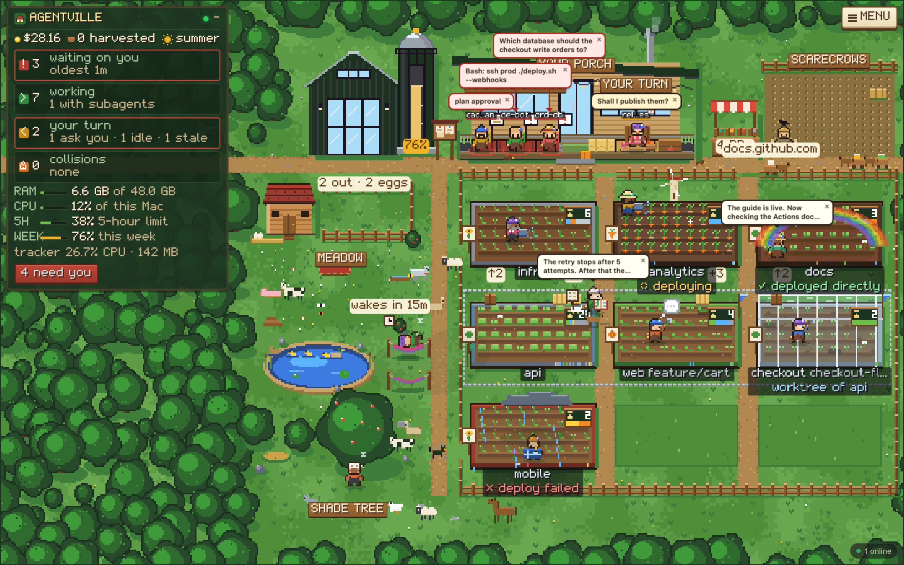
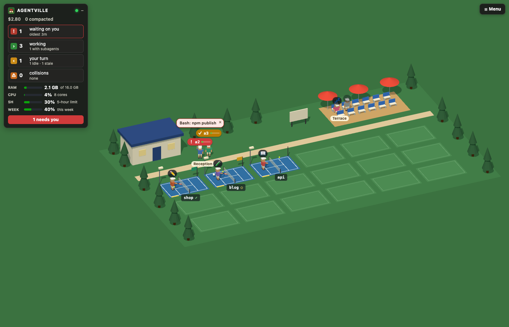

# Agentville

**A live dashboard for your Claude Code and Codex sessions.** It shows Claude Code sessions with
their subagents and background jobs, and Codex sessions read-only. See who is waiting on you, what
each agent is doing and what it costs. Answer, message and steer Claude Code sessions from one page,
and watch them work as farmers on a pixel farm. Runs on macOS, Linux and Windows.



Everything runs on your machine. The collector is a small Node program that reads what Claude Code
already writes to disk and listens on `127.0.0.1` unless you turn on network access.

## What it can do

- **See everything:** every session sorted by what needs you, its current tool, subagents, model,
  context, cost, plan usage, CPU and memory, plus each repo's branch, changes, deploys and pull
  requests. Collisions (two agents in the same files) are flagged.
- **Respond:** answer questions and permission prompts, message a session with files, broadcast to
  several, ask a side question (`/btw`), keep notes.
- **Steer:** start, resume, fork, restore, stop, restart and end sessions; switch model, effort,
  permission mode or Claude account.
- **Manage Claude Code:** plugins and skills with their context cost, MCP servers, permission rules.
- **Read what agents wrote:** files with git status, documents, pictures, PDFs, spreadsheets.
- **Get notified:** system notifications, a bell in the page, a pane and toasts inside Claude Code.
- **Worlds:** the dashboard as a pixel farm, a robot factory or a tennis club in 3D, or a world you
  make yourself. Every browser shows the same world at the same moment.
- **Share it:** other devices on your network can watch read-only, optionally limited by IP, behind
  a password and over HTTPS. A kiosk can keep its screen on.

Details: [docs/guide.md](docs/guide.md).

## Requirements

- macOS, Linux or Windows (11, checked with Windows PowerShell 5.1, Windows Terminal and Git for Windows).
- Node.js 22 or newer.
- Claude Code with plugin mods (tested on 2.1.293).
- Optional: the GitHub CLI (`gh`), signed in, for deploys and pull requests.
- Optional on Linux: a terminal emulator or `tmux` to start sessions, `notify-send`, `zenity` or
  `kdialog`. LibreOffice (Linux, Windows) previews Word files and slides.
- On Windows, sessions open in Windows Terminal when it is installed, else in a PowerShell window.

`agentville doctor` lists what it found.

## Install

```bash
git clone https://github.com/DS09AT/agentville.git
cd agentville
npm install
npm link        # puts the agentville command on your PATH
agentville
```

`agentville` installs the collector as a service that starts at login and prints the dashboard
address (<http://localhost:7777>). There are no environment variables, config files or paths to set.

- The service runs from the cloned folder, so keep it.
- Data lives in `~/.agentville` (`config.json`, `state/`, `logs/`, `worlds/`).
- `claude`, `git` and `gh` are found through your login shell's `PATH`.
- The Claude Code mod is registered automatically. Run `/reload-plugins` in sessions that are
  already open.
- With a system-wide Node on Linux, `npm link` may need `sudo`.
- On macOS, allow the tracker to control Terminal or iTerm when asked.

### Start, stop, restart

```bash
agentville             # install if needed, start, print the address
agentville status
agentville stop
agentville start
agentville restart
agentville logs
agentville open        # open the dashboard in your browser
agentville doctor      # what was found, what is missing
agentville uninstall   # stop it and remove it from login (data stays)
```

The service belongs to your user and starts at login:

| | Service | Before login |
|---|---|---|
| macOS | launchd agent, restarted if it exits | no |
| Linux | systemd user service, restarted if it exits | yes, with `sudo loginctl enable-linger $USER` |
| Windows | `Run` registry key, no administrator and no window at login; not started again if it exits | no |

### Update and uninstall

```bash
git pull && npm install && agentville restart        # update
agentville uninstall && npm unlink -g agentville     # uninstall
```

Data stays in `~/.agentville` until you delete it.

## Using it

Open the dashboard. **☰ List** shows every agent with its details; **🌾 Farm** shows them as a
world. Click an agent to answer it, message it or read what it wrote. **＋ Session** starts or
resumes a session, **⚙ Claude Code** manages plugins, MCP servers and permission rules.

With the mod loaded, a session shows **📡 dashboard answers on** and can be answered, messaged and
switched from the dashboard. `/tracker` opens the agent list inside Claude Code.

Every part is described in [docs/guide.md](docs/guide.md).

## Worlds

- 🌾 **Farm:** every agent a farmer, every repo a field. Crops grow as context fills, weather shows
  the last deploy.
- 🏭 **Robot factory:** every agent a robot, every repo an assembly bay.
- 🎾 **Tennis club:** every agent a player, every repo a court, in 3D.
- **Your own:** `agentville new-world <name>` copies a starter into `~/.agentville/worlds`. One
  file describes the world; it is drawn in 3D ([docs/worlds.md](docs/worlds.md)).



The collector moves each world, so every browser shows the same picture. On the farm and in the
factory anyone watching can ask an animal for an action. A world you make runs sandboxed and sees
no names or text until you tick **Can see what agents say** for it.

## Settings

**⚙ Settings** in the dashboard edits `~/.agentville/config.json`. Only the dashboard on the
collector's own computer has it. Changes apply immediately; settings marked ↻ restart the collector.

| Key | Meaning (default) |
|---|---|
| `lan` ↻ | Network access: other devices can open the dashboard read-only (off) |
| `port` ↻ | The dashboard's port (7777) |
| `https` ↻ | Encrypts the connection; HTTP redirects to HTTPS (off) |
| `guestPassword` | Password for other devices (none) |
| `guestAllow`, `guestBlock` | IPs and ranges that can or can never connect (empty: private networks only) |
| `terminal` | Where sessions open (`"auto"`) |
| `claudeBin` ↻ | Path to Claude Code, if it is not on your `PATH` |
| `mod`, `modToasts` | Register the mod in Claude Code; show toasts in sessions (on) |
| `staleAfterHours`, `collisionWindowMin` | When an agent is stale (24); how far back writes collide (30) |
| `permissionDashboardSec`, `permissionGuessSec` | Permission prompts on the dashboard (15 s; 0 = off); when a prompt is assumed (20 s) |
| `notifications`, `notify` | All system notifications, and each kind (on) |
| `memoryAlertGb`, `cpuAlertPct`, `cpuAlertSustainSec` | When an agent runs hot (2 GB; 90% for 120 s) |
| `worldsDir` ↻ | Folder with your own worlds (`~/.agentville/worlds`) |
| `deployRepos` | Checkout path → `owner/repo` whose latest Actions run is shown |
| `accounts` | Claude config folder → display name |
| `pollMs`, `agentsCliPollMs`, `gitPollMs`, `deployPollMs`, `prPollMs` | Polling intervals |

`config.example.json` lists every key with its default.

### Network access

Turn it on under **⚙ Settings › Network** or with `agentville lan on`. Other devices see who works
where and the worlds. They never get conversations or files and cannot change anything.

| Setting | Effect |
|---|---|
| **Allowed addresses** | Only these IPs or ranges can connect. Empty allows private networks only |
| **Blocked addresses** | These IPs or ranges can never connect |
| **Password** | Other devices must sign in first. They stay signed in for a year or until the password changes |
| **HTTPS** | Encrypts the connection and redirects HTTP to HTTPS |

HTTPS uses a self-signed certificate (valid 99 years, kept in `~/.agentville/state/tls`), so each
browser asks you to accept it once. For access from outside your network use a VPN.

### Keeping a screen on

**Screen** in a world's Menu keeps that device's screen on while the dashboard is open. It is a
per-browser switch. Add `?kiosk=1` to the address to turn it on without touching the device. It
needs HTTPS or `localhost`.

## Commands

| Command | Does |
|---|---|
| `agentville` | Installs the service if needed, starts it, prints the address |
| `agentville open` | Opens the dashboard in your browser |
| `agentville status` | Shows whether it runs and answers |
| `agentville start` / `stop` / `restart` | Starts, stops or restarts the collector |
| `agentville logs` | Prints the last log lines |
| `agentville lan on` / `off` | Turns network access on or off |
| `agentville doctor` | Lists what was found and what is missing |
| `agentville uninstall` | Stops the service and removes it from login |
| `agentville run` | Runs the collector in this terminal |
| `agentville new-world <name>` | Creates a world from the starter |
| `agentville check-world <world>` | Runs a world's test tour and reports problems |

`AGENTVILLE_HOME=<folder>` runs a second collector with its own data folder.

## Privacy and security

- Nothing leaves your computer, except `gh` asking GitHub about your own repos and the ✨ Helper,
  which is off by default.
- Other sites open in your browser cannot read the dashboard or act for you.
- Other devices get read-only access: no conversations, files, settings or actions.
- With a password set, a device that has not signed in gets only a sign-in form.
- Worlds run sandboxed and can never act for you. A world you add gets numbers instead of names
  until you allow more.
- Outside `~/.agentville`, Agentville adds a login entry and one entry in your Claude Code
  settings. `agentville uninstall` removes both.

Details: [docs/security.md](docs/security.md).

## Troubleshooting

| Problem | Fix |
|---|---|
| The dashboard doesn't load | `agentville status`, `agentville logs`, `agentville doctor` |
| A session shows "dashboard answers off" | Run `/reload-plugins` in it. Check **⚙ Settings › Sessions › Claude Code mod** |
| Another device can't open it | Turn on network access; check allowed and blocked addresses; with HTTPS, open `https://` and accept the certificate |
| **Screen** won't stay on | Turn on HTTPS and open the dashboard by `https://` |
| Sessions can't be started (Linux) | Install a terminal emulator or `tmux` |
| It stops when I log out (Linux) | `sudo loginctl enable-linger $USER` |

More: [docs/guide.md](docs/guide.md#troubleshooting).

## Known limits

- Only Claude Code and Codex are supported. Other agents don't appear.
- Only sessions that load the mod can be answered, messaged or switched from the dashboard.
- Codex sessions are read-only.
- Windows: nothing starts the collector again if it exits before your next login (a logon task needs
  an administrator). Allowing network access can make Windows Defender Firewall ask once; allowing it
  takes an administrator. `npm run test:ui` and the demo scripts are for macOS and Linux.
- Windows: where `claude` is only a `claude.cmd` (no `claude.ps1` or `claude.exe` beside it), the text
  for the prompt box of a ⑂ Fork from your message is left out, with a warning, when it holds
  `& | < > ^ % !` or a quote: `cmd.exe` would read them as its own.
- claude.ai cloud sessions and Remote Control sessions on other machines aren't visible.

More: [docs/guide.md](docs/guide.md#known-limits).

## Development

```
bin/         agentville.mjs, the command
collector/   the collector and its tests (test/)
web/         the dashboard; worlds/ holds the worlds, the starter, the SDK and the pixel engine (legacy/)
mod/         the Claude Code mod and its tests
scripts/     end-to-end checks, world tools, demo videos
docs/        guide.md, security.md, worlds.md, worlds-legacy.md, screenshots
```

```bash
npm install
npm test                    # collector and dashboard
npm run test:ui             # the dashboard in headless Chrome
claude plugin test mod      # the Claude Code mod
npm start                   # run the collector in the foreground
AGENTVILLE_HOME=/tmp/av npm start   # a second collector with its own data folder
```

GitHub Actions runs `npm test` and `npm run test:ui` on Linux. `main` takes changes only through
pull requests. Commit messages follow [Conventional Commits](https://www.conventionalcommits.org):
release-please reads them to bump the version and write `CHANGELOG.md`. More scripts are in
`package.json`.

## License

MIT
