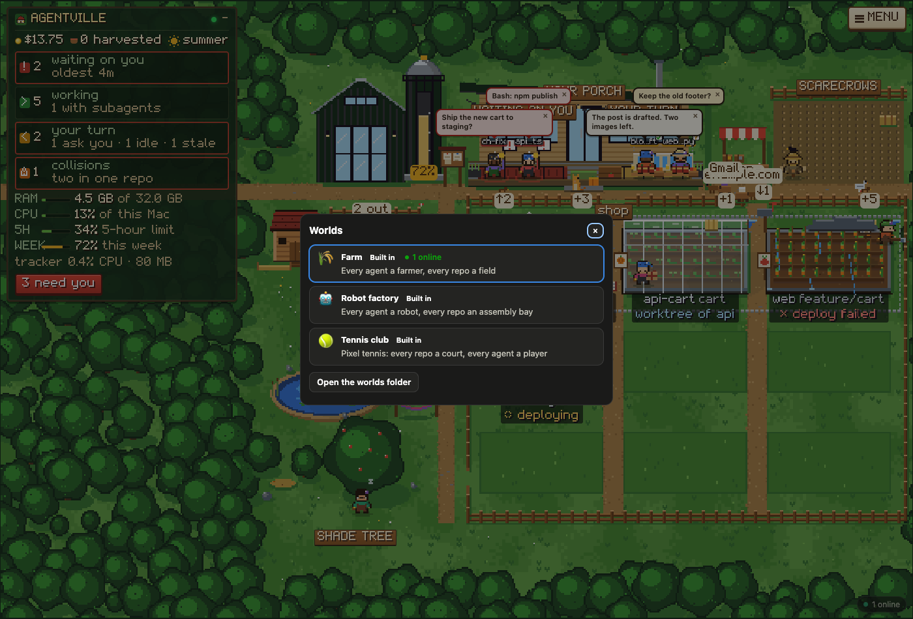
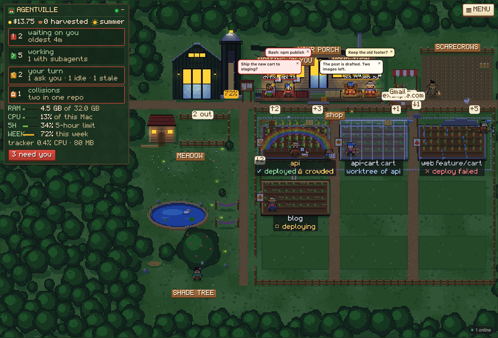
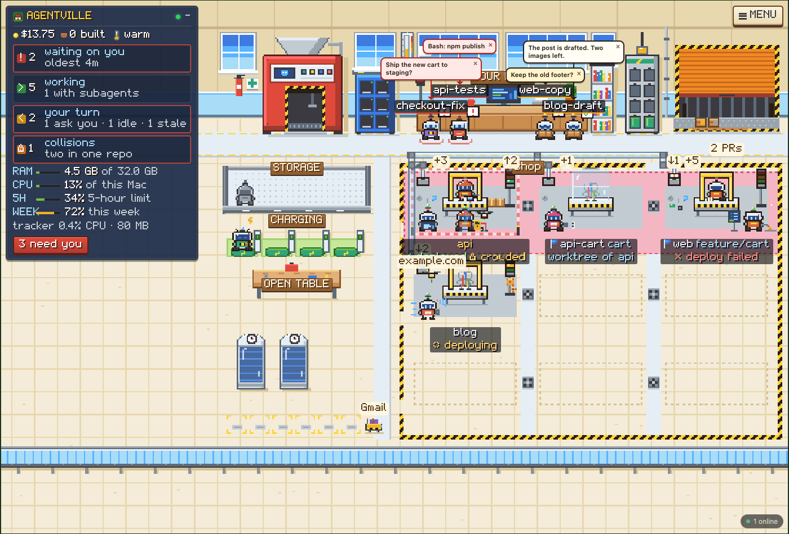

# Using Agentville

Install, settings and commands are in the [README](../README.md). Privacy and security are in
[security.md](security.md). To build your own world, see [worlds.md](worlds.md).

## The dashboard

**☰ List** and the button beside it switch between the list and the world you chose (the farm by
default). The **▾** opens the list of worlds. Both views show the same data, updated every few
seconds.

| State | Meaning |
|---|---|
| **waiting** | It needs you: a question, a plan to approve, or a permission prompt |
| **working** | It is busy |
| **your turn** | It finished its turn |
| **idle** | Nothing happening |
| **stale** | No activity for a day (changeable in Settings) |

### The list view

- **Left:** the agents, waiting ones first, then your repos with branch, last deploy, pull requests
  and the agents in them.
- **Centre:** the agent you picked: state, folder, model, controls, CPU, memory, context, cost, its
  current tool (**Now**), running shell commands with **Output** and **■ Stop**, the message box
  and the conversation. A **Subagents** tab lists each subagent with its task, steps and result.
- **Right:** the agent's folder with git status, its scratchpad and its memory.
- **Top:** memory and CPU of all agents, your plan's 5-hour and weekly usage, and cards for
  Waiting on you, Working, Your turn and Collisions. The tab title counts the agents that need you.

### Answering and messaging

These need the mod in that session.

- **Questions** show with their options and an "Other" box. **✕ Cancel** dismisses them and stops
  the turn, as Esc does.
- **Permission prompts** show the command with **Allow**, **Always allow…** and **Deny**. You have
  15 seconds on the dashboard (changeable in Settings), then the terminal asks. Sessions in bypass,
  don't-ask or auto mode never prompt here.
- **Messages** arrive as your own prompt. Enter sends, Shift+Enter starts a new line.
- **Messages to a busy session wait** under the box until its turn ends. Each has **✕**, **Edit**
  and **⚡ Send now**. **Send together** sends all waiting messages as one.
- **↑ / ↓** recall what you sent before, as in the terminal.
- **Attachments:** paste, drop or use 📎, up to 6 files of 10 MB each. **📁 Folder** sends a
  folder's path; nothing is uploaded.
- **Reply** quotes a message. **⤢ Read all** opens the whole conversation with search.
- **📣 Broadcast** sends one text message to every agent you tick. ⌘↩ sends.
- **■ Stop** ends the turn at once, as Esc does. A message you sent while it worked becomes its
  next prompt. Background commands keep running; stop those under **Commands running**.
- **Side question** asks the session something like `/btw`: answered from the conversation, with
  no tools, and nothing is added to the conversation.
- **Notes** keep what you may want to tell a session later. **↳ Use** puts a note in the message
  box, **Send now** sends it. Notes stay after the session ends; a fork gets a copy. Up to 200 notes
  of 4,000 characters per session.

### ✨ Helper

The Helper uses Haiku for small writing jobs. It is off until you switch it on, and its calls
count against your Claude plan.

- **Name suggestions:** a new session with Claude Code's default name is offered a short name.
  **✓ Rename** renames it. Haiku gets the session's first three messages and the start of the
  first reply.
- **Animal lines:** Haiku writes what the animals say about what is happening. It gets agent and
  repo names, states and counts, never code, paths, commands or conversation text.
- A daily limit (200 by default) caps the calls.

### Sessions

- **Model and effort:** pick another in the session's bar. It switches after the current turn. As
  with `/model` in the terminal, this also changes your default for new sessions.
- **Compact…** summarises the conversation to free context, optionally with a hint what to keep.
- **Restart in…** ends the session and resumes it in another permission mode, or on another Claude
  account.
- **＋ Session** starts Claude Code in a folder or resumes a past session. Type a path, **Browse…**,
  or pick a folder you worked in. Only folders in your home folder or on a mounted drive can be
  used. Past sessions can be searched, filtered and sorted. You pick permission mode, model, effort
  and account.
- **⑂ Fork** on a message starts a new session from the conversation at that point. On one of your
  messages, the message waits in the new session's prompt box.
- **↺ Restore** on one of your messages puts the session back to just before it, as `/rewind` does:
  conversation, code, or both. Only files Claude changed with its edit tools are put back, not
  changes made by shell commands or by you.
- **End session** stops Claude and closes its terminal window.

### Several Claude accounts

Claude Code keeps login, settings and history in one config folder (`~/.claude`). Give each
account its own folder to use them side by side.

```bash
# 1. An alias per account, in ~/.zshrc or ~/.bashrc
alias claude-work='env -u CLAUDE_CONFIG_DIR claude'
alias claude-home='CLAUDE_CONFIG_DIR="$HOME/.claude-home" claude'

# 2. Share instructions, settings, skills and commands (not .claude.json or plugins)
mkdir -p ~/.claude-home
for f in CLAUDE.md settings.json settings.local.json skills commands agents; do
  [ -e ~/.claude/$f ] && ln -s ~/.claude/$f ~/.claude-home/$f
done

# 3. Optional: share history, so a conversation can move between accounts
ln -s ~/.claude/projects ~/.claude-home/projects
ln -s ~/.claude/file-history ~/.claude-home/file-history

# 4. Log in
claude-home    # then /login
```

- Agentville finds every `~/.claude-<name>` folder with a login within a minute. Name accounts
  under **⚙ Settings › Claude accounts**.
- The top bar shows a plan block per account, and every agent carries its account's tag.
- ＋ Session, ⑂ Fork and Restart in… let you pick the account. Moving or resuming a conversation on
  another account needs the shared history of step 3.
- Use the same folder path every time, or Claude Code asks you to log in again.
- The ⚙ Claude Code dialog shows the first account's plugins, MCP servers and rules.

### ⚙ Claude Code

- **Plugins & skills:** every plugin with what it costs in context. Turn on or off, update,
  uninstall. **Reload running sessions** makes open sessions pick up the change.
- **MCP servers:** each server's state (connected, needs sign-in, failed), with **Sign in** and
  **Remove…**. The check takes about 15 seconds.
- **Permission rules:** allow, ask and deny rules from your settings and each project's.
  **Remove…** deletes one.

### Files

Click a file in the explorer to open it read-only.

| File | Shown as |
|---|---|
| Markdown | rendered |
| Code | text with line numbers |
| Pictures, PDF, video, audio | as themselves |
| HTML | the page, sandboxed, or its source |
| Word (docx, doc, rtf, odt) | page or text (needs LibreOffice on Linux and Windows) |
| Excel (xlsx), CSV | tables, first 2,000 rows and 100 columns |
| PowerPoint, Keynote, Pages, Numbers | a picture of the first page (needs LibreOffice on Linux and Windows) |

- Select text and **Quote** it to reply about that passage.
- A picture, video, PDF or document named in a reply shows under the reply, if it is inside the
  agent's folder, scratchpad or memory and not git-ignored.
- **Show in Finder** (Explorer, file manager) reveals a file without opening it.
- Limits: text files 2 MB, media 200 MB, documents 50 MB, 5,000 files in the explorer.

## Worlds

A world draws what the dashboard knows. **World** in a world's Menu opens the list. Each world
keeps its own zoom and settings per browser.



### One world for everyone

Every open dashboard shows the same picture at the same moment: yours, a second screen, a device on
your network.

- **Shared:** who walks where, the animals and their gags, carts, pigeons, pop-ups, and the time of
  day.
- **Per browser:** the world you chose, the theme, and a world's switches (Sky, Season, Motion,
  Animals, Bubbles, Resting, zoom, Bell, Screen).
- **Online count:** a chip at the bottom right shows how many browsers are looking; the list of
  worlds shows the same count per world. Click the chip to see who is there and to set your name.
- **Animal actions:** anyone watching can ask an animal for an action. A free figure walks over
  and does it. At most five figures are out at once; the rest wait in line.
- **Your own worlds** are shared the same way. At most six of them run at once.

### Your own worlds

- `agentville new-world <name>` creates a world from the starter in `~/.agentville/worlds/<name>/`.
  One file, `world.json`, describes it, and it is drawn in 3D. How to make one: [worlds.md](worlds.md).
- A world made for the older pixel engine keeps working ([worlds-legacy.md](worlds-legacy.md)).
- **Privacy mode:** a world from your folder gets numbers instead of names (`repo 1`, `agent 1`)
  and no text or paths. Tick **Can see what agents say** in the list to show it everything, per
  browser. Do that only for a world you trust.
- Saving a file in a world's folder reloads that world on screen.

### The farm



Barn, silo and farmhouse stand along the top, the fields below (one bed per repo, up to 18), the
henhouse, meadow and pond on the left. The **i** button in the Menu opens the full legend.

| You see | It means |
|---|---|
| A farmer on the porch's left, waving a red **!** | Waiting on you |
| A farmer on the porch's right with a basket | Its turn ended (a **?**: it asked you something) |
| A farmer in a field with a tool | Working in that repo. Almanac = reading, spyglass = searching, hoe = editing, magnifier = tests, hammer = build, crate = commit, cart = push |
| A thought cloud / a chore board | Thinking / its task list |
| Hearts in its name, crops growing | Context left / context filling |
| **Harvest!** | Its conversation was compacted |
| A pin on its hat | Model: purple Opus, blue Sonnet, green Haiku, orange Fable |
| Speed lines / a red-and-white scarf / a blueprint | Fast mode / bypass permissions / plan mode |
| A purse | Cost so far (gold from $50) |
| Hens, a dog | Subagents (a brown hen: Codex; the dog: Explore) |
| A pump by a bed | A background command |
| A hammock | It will wake itself up (`/loop`) |
| Under the shade tree / a scarecrow | Idle / stale |
| A cart on the road | A web fetch or search |
| Carts by the road to town | MCP servers called in the last hour; a cart drives to the farmer calling it |
| A pigeon | One session messaging another |
| Hay / crates / a mailbox above a field | Uncommitted files / unpushed commits / commits behind |
| Rainbow / rain / windmill | Last deploy passed / failed / running |
| Rope with orange flags | Two agents writing to the same repo |
| A blue pennant / a greenhouse | A branch other than main / a worktree |
| The market stall | Open pull requests. **Sold!**: one was merged |
| The silo's grain / the season | Weekly plan usage / 5-hour limit (winter when nearly used up) |
| A second silo | A second Claude account, or Codex |
| Eggs in the nest | Subagents done within the hour |

**Controls.** The panel (top left) shows cost, counts and gauges; click a count to open its first
agent. The **Menu** (top right) holds the dashboard's buttons and the farm's switches: Follow,
Resting, Bubbles, Animals, Sky, Season, Motion, Bell, Screen, Help and zoom. ⌘/Ctrl + scroll zooms,
drag moves.

**Clicks.** A farmer opens in the sidebar. A field shows the files agents touched there. A speech
bubble opens the conversation.

| Building | Opens |
|---|---|
| Barn | Start or resume a session |
| Farmhouse | Who is on your porch |
| Silo | Plan usage and reset times |
| Henhouse | Subagents |
| Notice board | Each project's CLAUDE.md and memory |
| Market stall | Pull requests |

**Sidebar.** One panel beside the farm for the agent you picked, with Chat, Activity, Subagents
and Files tabs, its question or permission prompt on top, and a line naming the other agents that
wait on you.

**Animals** are for fun: click one to pet or feed it. Idle farmers play with them. Switch
**Animals** off in the Menu to stop it.

### The robot factory



The same data as a workshop: every agent a robot, every repo an assembly bay. The **Help** button
opens the full legend.

| You see | It means |
|---|---|
| A robot left of your desk, waving a red **!** | Waiting on you |
| A robot right of your desk with a crate | Its turn ended |
| A robot at a bay with a tool | Working. Datapad = reading, scanner = searching, welder = editing, multimeter = tests, wrench = build, stamped crate = commit, rocket crate = deploy |
| A robot being built on the bench | Context filling: frame, wiring (30%), plating (50%), head (70%), eyes lit (85%) |
| **Built!** | Its conversation was compacted |
| The beacon on its head | Green working, red waiting, amber your turn, blue idle |
| The light on its antenna | Model: purple Opus, blue Sonnet, green Haiku, orange Fable |
| A badge on its chest | Cost: copper from $1, silver from $10, gold from $50 |
| Mini drones / a delivery drone | Subagents / a web fetch or search |
| AGVs on the left | MCP servers called in the last hour |
| A capsule in the tubes | One session messaging another |
| Loose parts / boxed parts / a capsule at the tube outlet | Uncommitted files / unpushed commits / commits behind |
| Stack light green / red / amber / grey | Last deploy passed / failed / running / not run |
| Hazard tape round a bay | Two agents writing to the same repo |
| A charging pad / the storage shelf | Idle / stale |
| Crates on the loading dock | Open pull requests |
| The power-cell bank / the floor heat | Weekly plan usage / 5-hour limit |

| Building | Opens |
|---|---|
| Fabricator | Start or resume a session |
| Your desk | Who is waiting on you |
| Power-cell bank | Plan usage and reset times |
| Drone dock | Subagents |
| Manuals shelf | Each project's CLAUDE.md and memory |
| Loading dock | Pull requests |

### The tennis club


The same data in 3D: every agent a player, every repo a court. Every world drawn in 3D, yours too,
shows agents the same way. **Help** in the Menu lists every sign.

| You see | It means |
|---|---|
| A player at reception, waving, with a red **!** or **?** | Waiting on you: a permission or a question |
| A player at reception with an amber **✓** | Its turn ended (a **?**: it asked you something) |
| A player on a court, with a sign over it | Working in that repo. The sign is its step: ✏️ editing, 📖 reading, 🔍 searching, 🧪 tests, 🔨 build, 🔖 commit, 🚀 deploy |
| 💭 | Thinking, or between two steps |
| The bar in a name tag | Context used |
| **Compacted** | Its conversation was compacted |
| Small orbs circling a player | Subagents |
| A letter in the air | One session messaging another |
| A player on the terrace, 💤 / grey, **…** | Idle or napping / stale |
| Signs beside a court's name: ✓ ✗ ◌ / ⚠ / ●3 ↑2 ↓1 / #2 | Last deploy passed, failed, running / two agents writing the repo / uncommitted, unpushed, behind / open pull requests |
| The scoreboard / the floodlight / the yellow line | Last deploy / someone works there / context used |
| **Merged #12** | A pull request was merged |

**Controls.** The panel (top left) shows cost, counts and gauges; click a count to open its first
agent. The **Menu** (top right) holds the dashboard's buttons and the switches: Follow, Resting,
Bubbles, Sky, Motion, Bell, Screen, Help and zoom. ⌘/Ctrl + scroll or a pinch zooms, drag moves.

**Clicks.** A player opens in the sidebar. A court or its name shows the files agents touched
there. A speech bubble opens the conversation. The clubhouse starts or resumes a session; the
notice board shows each project's CLAUDE.md and memory.

## Notifications

- **System notifications** come from the collector: an agent needs you, finished, collides with
  another, or runs hot. Turn off each kind, or all, under **⚙ Settings › Notifications**.
- **Bell** (in a world's Menu) chimes in the page when an agent starts waiting on you.

## Inside Claude Code: the mod

The mod connects a session to the dashboard: it delivers your answers and messages, switches model
and effort, and reports cost and plan usage. In the session it adds `/tracker` (a pane listing all
agents), a status line and toasts.

Agentville registers the mod in Claude Code by itself. Turn that off under
**⚙ Settings › Sessions › Claude Code mod**. A session opened before an update keeps the old mod
until you run `/reload-plugins` in it.

## Troubleshooting

| Problem | Fix |
|---|---|
| The dashboard doesn't load | `agentville status`, `agentville logs`, `agentville doctor`. Check that nothing else uses the port |
| The service runs but nothing answers | `agentville logs` shows why, usually a port in use. After a Node.js update, run `agentville install` again |
| Another device can't open it | Turn on network access. With HTTPS on, open `https://<address>:7777` and accept the certificate. Check allowed and blocked addresses. If HTTPS is on and its certificate can't be created, Agentville stays off the network: `agentville logs` says why |
| No device can sign in with the password | Set it under **⚙ Settings › Network**. A password typed into `config.json` by hand is not accepted |
| A browser warns about the certificate | It is self-signed. Accept it once per browser |
| **Screen** won't stay on | Needs HTTPS or `localhost`. iPads need iOS 16.4 (18.4 as a home-screen app) |
| Sessions can't be started (Linux) | Install a terminal emulator, or `tmux` without a display |
| It stops when I log out (Linux) | `sudo loginctl enable-linger $USER` |
| ＋ Session or End session does nothing (macOS) | Allow the tracker to control Terminal or iTerm: System Settings → Privacy & Security → Automation |
| A session shows "dashboard answers off" | Type anything in it or run `/reload-plugins`. `agentville doctor` shows whether the mod is registered |
| A message waits and never goes out | It goes out when the turn ends. **⚡ Send now** sends it at once |
| ■ Stop or ✕ Cancel is greyed out | `/reload-plugins` in that session |
| No cost, plan usage or working line | These come from the mod in a running session |
| An account shows "Signed out" or is missing | Run `/login` on it. Its folder must be `~/.claude-<name>`, or be added under **⚙ Settings › Claude accounts** |
| **Resume** is greyed out for an account | It doesn't share the session's history (step 3 above) |
| No pull requests or deploys | `gh auth status`. Deploys need the repo under **⚙ Settings › GitHub** |
| ↺ Restore could not restore files | File checkpointing may be off in Claude Code. Restore the conversation only |
| The bell is silent | Click the page once and allow notifications |
| My world shows `repo 1`, `agent 1` | It is in privacy mode: tick **Can see what agents say** |
| A world "didn't start" | Run `agentville check-world <name>` to see the error |
| A world says it "is drawn with WebGL" | Turn on hardware acceleration in the browser's settings, or pick the farm |
| Two browsers show different animals | Sharing is off (no "online" chip). Run `npm install` in the Agentville folder, then `agentville restart` |
| The animals say nothing new | Tick **Animal lines** in ✨ Helper; a session with the mod must be open |

## Known limits

- Only sessions that load the mod can be answered, messaged or switched from the dashboard.
- "Probably a permission prompt" is a guess and can be wrong.
- Codex sessions are read-only and show no cost, CPU or memory.
- claude.ai cloud sessions and Remote Control sessions on other machines aren't visible.
- Windows: the collector is not started again if it exits before your next login (a logon task needs
  an administrator). Network access can make Windows Defender Firewall ask once. Where `claude` is
  only a `claude.cmd`, the text for a fork's prompt box is left out when it holds `& | < > ^ % !` or a quote.
- On Linux, ending a session does not close a tmux session that holds more than Claude.
- ⑂ Fork and ↺ Restore rely on Claude Code options that a Claude Code update could change.
- Worlds drawn in 3D (the tennis club, and worlds you make) need WebGL and have no animals.
