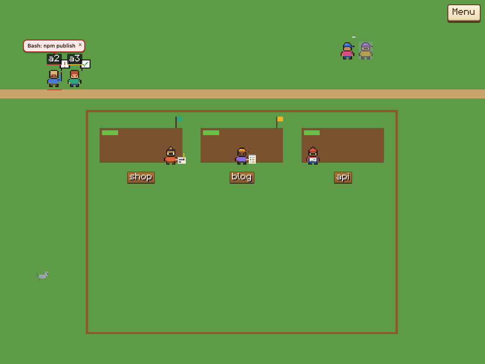
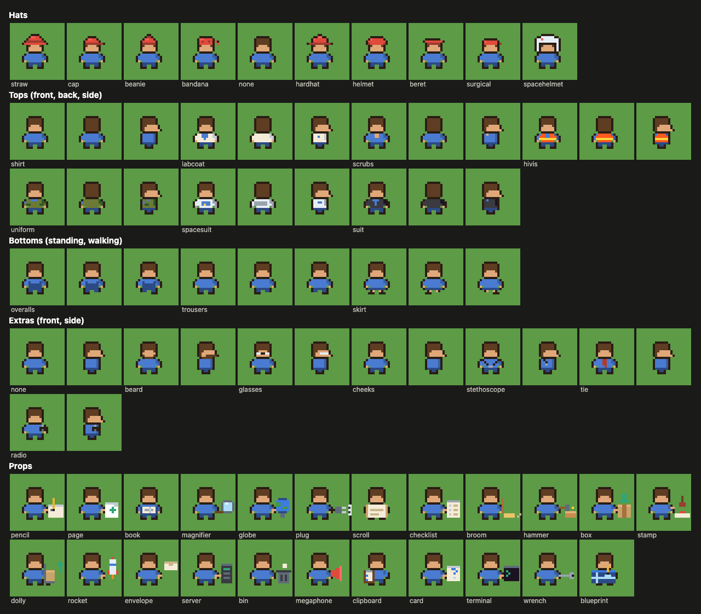

# Worlds of the pixel engine (api 1)

The farm and the robot factory are drawn by the pixel engine: a world of `"api": 1` is a `world.js`
of hooks that paint pixels on a canvas. This page is the reference for those worlds.

**New worlds are made for api 2**, which draws with three.js from a `world.json`:
see [worlds.md](worlds.md). The pixel engine stays until the worlds made for it have been moved
over. Worlds of both kinds run side by side, and nothing here changes while it stays.

What both kinds share is in [worlds.md](worlds.md): where worlds live, the scene, the test page and
the tour, privacy mode, the messages, what happens when a world breaks, what a world can't do, and
the gaps. A section named in quotes that is not on this page is there.

## What a world is

A world of the pixel engine is a folder with `world.json` and `world.js`, plus any pictures, sounds,
fonts and stylesheets they use (`.js`, `.json`, `.css`, `.png`, `.gif`, `.webp`, `.svg`, `.woff2`, `.mp3`,
`.ogg`, `.wav`) and, if you like, `preview.png` for the list of worlds.

The dashboard runs it in a sandboxed frame. The frame gets the **scene** (plain facts about agents
and repos) and reaches the page only through **messages**, each of which the page checks. It has no
token, cookies or storage and cannot fetch anything ("What a world can't do").

Before your `world.js`, the frame loads the pixel engine (`web/worlds/legacy/`): the pixel kit, the
people and props kits, the creature library and animals kit, the repo grid and the engine. The world draws into
`<div id="farm">`, which fills the frame.

Keys: the built-in worlds of the pixel engine are `farm`, `factory` and `legacy-starter`. Yours are
`u/<name>`.

## The worlds of the pixel engine

| World | Key | What it is |
|---|---|---|
| 🌾 **Farm** | `farm` | The default: every agent a farmer, every repo a field, with animals |
| 🤖 **Robot factory** | `factory` | Every agent a robot, every repo an assembly bay. `web/worlds/factory/world.js` is the second full example after the farm |
| 🌱 **Starter** | `legacy-starter` | A plain world of about 100 lines, to read and to copy by hand. Not in the list of worlds, but the test page and `check-world` run it |




## Making a world

`agentville new-world` makes a world of api 2 ([worlds.md](worlds.md)). For one more world of the
pixel engine, copy the starter by hand:

1. Copy `web/worlds/legacy-starter/` into your worlds folder as `<name>/`, and give it a `name` in
   its `world.json`.
2. Edit the world. In `world.json` set `icon`, `description` and `nouns` ("world.json"). In
   `world.js` start from the starter's hooks ("The starter world"). "Hooks" lists each hook and its
   default; the kits draw people, what they hold, and animals.
3. Open the test page, `http://localhost:7777/worlds/test?world=u/<name>`. It plays the tour ("The
   test page and the tour"). Reload it after each save.
4. `agentville check-world u/<name>` runs the tour headless. Fix every line with a ✗ and read the
   lines with a · ("check-world and the checklist").
5. `npm run world-shots -- u/<name>` (in a clone, needs Chrome) saves a picture of each stop to
   `.private/shots/u-<name>/`. Look at each one.
6. Choose it in the dashboard: **World**, then its name. Saving a file reloads it. It gets the
   private scene until you tick **Can see what agents say** ("Privacy mode").

## world.json

The farm's:

```json
{
  "name": "Farm",
  "icon": "🌾",
  "description": "Every agent a farmer, every repo a field",
  "api": 1,
  "nouns": { "agent": "farmer", "agents": "farmers", "repo": "field", "repos": "fields", "start": "barn", "diary": "Farm diary" },
  "taken": ["chicken", "dog", "pigeon"]
}
```

| Field | Rule | Meaning |
|---|---|---|
| `name` | 1 to 40 characters | Shown in the list of worlds and on the view button |
| `icon` | optional, one emoji; 🧩 without | Beside the name. `preview.png` replaces it in the list |
| `description` | optional, up to 140 characters | One line in the list |
| `api` | `1` | The pixel engine. (`2` is a world of [worlds.md](worlds.md), with fields of its own) |
| `nouns` | optional; `agent`, `agents`, `repo`, `repos`, `start`, `diary`, each up to 30 characters | What the world calls things. `diary` titles the world's diary in the sidebar |
| `taken` | optional, up to 16 creature kinds | Shapes the world uses for data. Its animals may not take them ("Creatures") |

The file is at most 64 KB. Other fields are ignored.

## Hooks

A world drawn by the engine passes its hooks to `Agentville.world(hooks)`. The engine fills in a
default for each hook left out. (A world that draws everything itself uses `Agentville.raw`:
"Running a world".)

```js
(() => {
  Agentville.world({ W: 400, slots(agent) { … }, drawChar(agent, body) { … }, bg(fill, season, ext) { … } });
})();
```

Wrap `world.js` in a function like this. The SDK's top-level names share the frame's scope, so a
top-level `function` of yours with an SDK name (`makeGrid`, `engineScene`…) replaces the SDK's, and
a `const` with one (`px`, `ACTIVE`…) is a SyntaxError.

### The four a world must give

- `W`: the world's width in world pixels.
- `slots(agent)`: where the agent stands. One of:
  - `{ group, cap, at(i) → [x, y], zone }`: room for `cap` agents of the same `group`. Agents over
    the cap are not drawn; `labels` gets the count as `overflow[group]`. Optional
    `extra(k) → [x, y]`: where the k-th one over the cap appears when a job calls it ("Creatures").
  - `{ group: 'st:<key>', at(usedOffsets) → [x, y], zone }`: an agent standing in a field. Push the
    offset you took into `usedOffsets`.
  - `null`: the agent is off the map.

  With `direct: true` the agent walks there in a straight line instead of along the corridors.
- `drawChar(agent, body)`: draws the agent. `body` has `x`, `y`, `walk`, `face`, `lift` and `zone`.
- `bg(fill, season, ext)`: draws the ground. `fill(x, y, w, h, colour)` paints a rectangle. `ext` is
  `{ x0, x1, y0, y1 }`, the area to cover. `season` is the season to draw ("Seasons").

### The optional ones, with their defaults

**Layout and movement**

| Hook | Default | What it does |
|---|---|---|
| `corridors` | `[W / 2]` | x positions of the paths agents walk down |
| `route({ x, y }, tx, ty)` | `null` | Waypoints `[[x, y], …]` ending at `[tx, ty]`, when the corridors would lead across something. Called for every walk |
| `grid` | 3 beds of 88 × 62 centred on `W` | A `makeGrid` result or its config |
| `layout()`, `relayout(ground)` | the grid's ground | `relayout` keeps the new ground and returns it |
| `spawn()` | `[W / 2, 0]` | Where a new agent appears. A third item `[[x, y], …]` is its first steps |
| `speed(agent)` | `40` | Walking speed |
| `follow(body, k, T, kid)` | the engine's | Where the k-th subagent stands beside its agent |
| `chickens()` | the engine's followers | `[{ x, y }]`, for a world that moves the subagents' animals itself |
| `waitSpot(k)` | `null` | `[x, y]` where the k-th agent waiting for a job stands ("Creatures") |
| `SH` | `16` | A character's height |
| `key` | `'world'` | A short name for the world. The engine doesn't read it |

**Scene and state**

| Hook | Default | What it does |
|---|---|---|
| `fromScene(sceneV1)` | `engineScene` | The scene the engine acts out. A world may keep an agent or field the page no longer has, with a `state` of its own; its tag gets the class `st-<state>` |
| `setScene(scene)` | `[]` | May return events `{ id?, at?: [x, y], text, cls?, log?, who?, kind?, own? }`: a pop-up over agent `id` or at `at`; `log` adds a diary line; `kind` makes the animals react ("Reactions"); `own: true` pops only in this browser |
| `attach({ prefs })` | nothing | Called once before the first scene. `prefs.get(key)` and `prefs.set(key, text)` are the world's saved settings, 64 at most |
| `tick(dt, posOf, snap, told)` | nothing | Called each frame. `posOf(id)` is an agent's body (`x`, `y`, `tx`, `ty`, `path`). `snap`: the world is drawn still. Return `true` when your agents' places changed, so the engine asks `slots` again. `told`: "One world for everyone" |
| `share()`, `adopt(got)` | nothing | "Sharing your world's own things" |
| `onMove(agent, zone, prevZone, pop)` | nothing | `pop(text, cls)` shows a pop-up over the agent |
| `emit(agent, body, dt, addParticle)` | nothing | Particles for one agent, each frame |
| `ambient(dt, addParticle)` | nothing | Particles for the world, each frame |

**Drawing**

| Hook | Default | What it does |
|---|---|---|
| `ground()`, `shadows(body)`, `drawFx(agent, body)`, `top()` | nothing | Drawn under the agents, under each agent, over each agent, over everything. A walking agent is drawn over standing ones and what they hold |
| `items()` | `[]` | Each `[y, draw]`, drawn among the agents by `y`. Return a fresh array each call |
| `lights()` | `[]` | Each `[x, y, r, core?]` glows at night. `core` is `[x, y, w, h, panes?]`, what is lit; `panes: true` for a window |
| `weather(sky)` | nothing | Drawn over the sky |
| `flight(a, z, t, T)` | a carrier pigeon | Draws a message travelling from body `a` to body `z`; `t` runs from 0 to 1 over 2.4 s. A paper plane: `flight(a, z, t) { px(Math.round(a.x + (z.x - a.x) * t) - 2, Math.round(a.y - 20 + (z.y - a.y) * t), 5, 2, '#ffffff'); }` |
| `season()`, `seasonNames` | `'summer'`, no seasons | "Seasons" |

**Words, tags and labels**

| Hook | Default | What it does |
|---|---|---|
| `nouns` | `{ agent, agents, repo, repos, place: 'world' }` | The engine's words ("Loading the …"). Give all five |
| `help()` | a key naming your nouns | The info dialog's HTML |
| `startText(n)`, `arriveText`, `zoneText(agent, zone)` | "n agents here", `'arrives'`, `'moves'` | Diary lines: the first one, an agent walking in, an agent changing zone |
| `tag(agent, fit?)`, `tip(agent)` | the name, cut to 16; the name | The name tag and its tooltip |
| `tagSlot(agent)` | `null` | A number: the width of the tag's place in world pixels. Tags are then fitted, and `tag` gets `fit`, the characters that fit |
| `tagBadge(agent)` | `null` | `'ok'` or `'ask'` (a tick or question mark at the tag's corner), or `{ img, key }` for your own picture (`img` a data URL) |
| `labels(lab, overflow)` | each field's name under its bed | `lab(x, y, html, cls, title)` places HTML at a world position. `overflow` counts the agents over each group's `cap` |
| `labelKey()` | nothing | A string; `labels` runs again when it changes |
| `movers(posOf)` | `[]` | Moving HTML labels, each `{ key, html, title, x, y, cls? }`. With `cls: 'spot'` and `<button class="px-spot" data-farm-pick="<agent id>" data-farm-tab="subagents">`, a click picks that agent |
| `hud(state)` | the Menu button | "The HUD", below |

**Fields and buildings**

| Hook | Default | What it does |
|---|---|---|
| `fieldAt(x, y)` | `null` | The field under the point. A click opens its close-up |
| `fieldNotes(key)` | nothing | Your HTML above the files in a field's close-up. Escape what you put in it |
| `buildingAt(x, y)` | `null` | The key of the building under the point. `'barn'` opens ＋ Session, `'board'` opens the notice board, any other key goes to `dialog` |
| `buildingTip(key)` | `''` | Its tooltip |
| `dialog(key)` | `null` | `{ title, html }` |
| `boardSessions()` | `[]` | The agents the notice board is read from |
| `boardTitle` | `'The notice board: what your projects remember'` | A string, up to 80 characters |

**Animals** ("Creatures")

| Hook | Default | What it does |
|---|---|---|
| `animals()` | `[]` | The world's creatures: a list, or `{ cast, gags, play }` |
| `roam()` | `[]` | Rectangles `{ x, y, w, h }` where they may walk |
| `avoid()` | `[]` | Rectangles inside those that they keep off |
| `perches()` | `[]` | `[x, y, lift]` points a climber stands on |
| `dens()` | `[]` | `[x, y]` points where a creature with the `nap` habit sleeps |
| `spots()` | `{}` | Named points gags go to (`{ hammock: [x, y] }`), and `huddle`, where they gather in winter |
| `spotFree(name)` | `true` | Whether a gag may use that spot now |

### The HUD

By default the engine draws one **Menu** button at the top right. Its menu holds the dashboard's
buttons (list, world, sidebar, broadcast), then sky, season, motion, animals, bell, Screen, help and
zoom.

A `hud(state)` of your own returns the HTML. `state` is `{ still, zoom, saysOn, skyMode, seasonMode,
seasonNames, seasons, follow, canFollow, restingHidden, bell, awake, nav, panelOpen, animals,
menuOpen }`. The engine finds its buttons by attribute: `data-farm-menu`, `data-farm-nav="list"`,
`data-farm-nav="worlds"`, `data-farm-sky`, `data-farm-season`, `data-farm-animals`,
`data-farm-awake`. Keep a List and a World button. `animals` is `null` in a world without animals,
`seasons` is `false` in one without seasons.

Or call `panelHud` (below) for the farm's panel and menu in your words. A top-left panel with the
class `px-stats` never covers the world: the engine fits the world beside or below it.

### Seasons

A world has seasons when it gives a `season()` hook that returns `'spring'`, `'summer'`, `'autumn'`
or `'winter'` by a rule of its own. The farm's follows the plan's 5-hour limit. The HUD then gets a
**Season switch**: live, each season held, live again.

`seasonNames` renames the switch and its levels. The factory shows the limit as floor heat:

```js
seasonNames: { switch: 'Heat', spring: 'cool', summer: 'warm', autumn: 'hot', winter: 'steaming' },
```

Draw the season shown, not your own: `bg` gets it as `season`, and `PXG.season` holds it while the
engine ticks and draws. Use your live season only for what shows the person their real numbers.

Seasons for the starter, by the 5-hour limit (`scene`, `W` and `DOOR_Y` are the starter's names):

```js
// Inside the starter's function, beside its other names: the live season.
const liveSeason = () => {
  const w = scene.plan?.windows.find(x => x.kind === 'five_hour');
  if (!w) return 'summer'; // no reading yet
  const p = w.reset ? 0 : w.percentUsed;
  return p < 25 ? 'spring' : p < 60 ? 'summer' : p < 85 ? 'autumn' : 'winter';
};
```

Among its hooks, add `season: liveSeason,`. In `bg`, as its first line:

```js
fill(ext.x0, ext.y0, ext.x1 - ext.x0, ext.y1 - ext.y0, season === 'winter' ? '#e6eef5' : '#5d9b46'); // snow, or grass
```

At the end of `ground()`:

```js
if (PXG.season === 'winter') px(0, DOOR_Y + 1, W, 1, '#ffffff'); // snow along the path, held or live
```

### Drawing with the pixel kit

The pixel kit's names are global in the frame. Use them; don't declare them again. Everything is
drawn in world pixels, and the engine scales the canvas.

| Name | What it is |
|---|---|
| `PXG` | The drawing state: `PXG.ctx` (the 2D context), `PXG.T` (the animation clock in seconds), `PXG.season` (the season to draw) |
| `px(x, y, w, h, colour)` | Paints a rectangle, the colour snapped to the kit's palette |
| `blink(hz, n = 2)` | `0` … `n - 1`, turning over `hz` times a second |
| `pixelOrigin(body, SH)` | `[x, y]`: the top left of a 14-wide sprite `SH` high standing at `body` |
| `legFrame(body)` | The people kit's legs for `body`: `'s'` standing, or a walking frame |
| `rpAt(ox, oy)` | `rp(x, y, w, h, colour)`, a painter in a person's pixels from that origin |
| `bubble(rp, x, y, glyph)` | A speech bubble holding `'!'`, `'?'`, `'plan'` or, for anything else, a tick |
| `SC` | `1`: one sprite pixel is one world pixel |
| `ink(colour)`, `shade(colour, k)` | The nearest palette colour; darker for `k < 1`, lighter above |
| `makeSprite(rows, palette)` | A canvas from rows of letters (`.` clear) and a `{ letter: colour }` palette |
| `pxt(text, colour?, shadow?)` | HTML for text in the pixel font, for `labels`, `movers` and `dialog` |

### `makeGrid(config)`

The repo grid an engine world lays its fields out on. A repo keeps its bed, a project's repos sit
together, and a repo that leaves keeps its bed for a day. `config`:

- `cols` (3), `colW`, `rowH`: beds across, and each bed's width and height;
- `cx0`, `top0`: the centre x of the first column and the top of the first row;
- `minRows` (3), `maxRows` (6), `max` (18): rows shown, and beds in all (more show as "+N more");
- `slot(cx, rowTop)` → object: extra fields for each bed;
- `fence(rows)` → `{ x0, x1, y0, y1 }`: the fenced ground for that many rows;
- `height(fence)` → the world's height.

It returns `{ layoutFor(fields, beds?, now?), packedLayout(fields, beds, now?), slotAt(i), cols }`.
`layoutFor` returns `{ key, ST, slots, empty, rows, GRID, H, groups, more, beds }`. `ST` lists the
beds in use: each has the repo's `key`, `i`, `cx`, `rowTop` and whatever `slot` added. Find a repo's
bed with `L.ST.find(s => s.key === f.field)`. `GRID` is the fence.

If `grid` is a config, the engine fills in `cols` 3, `colW` 88, `rowH` 62, columns centred on `W`
and a fence half a column wider on each side.

### `engineScene(scene)`

Turns the version 1 scene into the engine's: `farmers` (the agents, each with `field`, its repo;
`pct`, the context used; `hearts`, left of 4; `shirt`, its colour; `account`), `fields` (the repos,
with `lastDeploy`), `plan.windows` (each with `percentUsed`), `accounts`, `henhouse`, `carts`,
`mail`, `subagents` and `chrome`. A world's `fromScene` can call it and add its own looks.

### `panelHud(params, words)`

The farm's stats panel (top left) and Menu (top right) in your world's words. It returns HTML, so a
world's `hud` can be one call:

```js
// Among your hooks: `scene` is the scene your setScene keeps, `liveSeason` your own season() ("Seasons").
hud: p => panelHud({ ...p, scene, season: liveSeason() }, { place: 'workshop', agent: 'tinker', agents: 'tinkers', compactedWord: 'tidied' }),
```

`params` is the `state` the `hud` hook gets, plus:

- `scene`: the engine's scene. Keep `accounts` in it, or the panel shows the first account's plan only;
- `season`: the live season;
- `iconImg(name)`: HTML for one of your icons, `''` for none. Names: `menu`, `list`, `world`,
  `plus`, `gear`, `side`, `broadcast`, `day`, `live`, `night`, `follow`, `resting`, `bubbles`,
  `animals`, `pause`, `play`, `bell`, `help`, and whatever `seasonIcon` returns;
- `seasonIcon(level)`: the icon's name for a season;
- `seasonTip(mode)`: the panel's season tooltip; `mode` is `'live'` or the season held.

`words` are text, never HTML. Any left out are plain ones built from `place`, `agent` and `agents`:

| Word | What it is |
|---|---|
| `place`, `agent`, `agents` | The nouns (up to 40 characters) |
| `costTip`, `costIcon` | The cost's tooltip and its icon's class (`coin`) |
| `compactedWord`, `compactedTip`, `compactedIcon` | The word after the number of compactions ("3 harvested"), its tooltip, its icon's class (`basket`) |
| `textColor`, `shadowColor`, `dimColor`, `labelColor`, `brandColor` | The panel's colours |
| `toolColor`, `toolStateColor` | The buttons' names and their states |
| `menuTip`, `menuHead` | The Menu button's tooltip, and the heading over your world's switches |
| `sideTip`, `followTip`, `followFirstTip`, `restingTip`, `bubblesTip`, `animalsTip`, `skyTip`, `seasonSwitchTip`, `motionTip`, `helpTip`, `zoomTip`, `zoomAllTip` | Tooltips |

To recolour the panel, add a style at the top of your function:

```js
const glass = document.createElement('style');
glass.textContent = '.px-stats { background: rgba(28, 42, 72, .92); border-color: #3a3a40; }';
document.head.append(glass);
```

## The people kit



`window.Agentville.people` draws a person, 14 × 16 pixels, from the front, the back or the side,
standing or walking.

A **look** is what one person wears: `{ hat, hatColor, band, hair, skin, top, bottom, bottomColor,
extra }`. An **outfit** is what a world offers: `{ hat?, hatColors?, hair?, skin?, top?, bottom?,
bottomColors?, extra? }`. `lookFor(agent, outfit)` picks a look by the agent's id, so an agent always
looks the same.

- Each outfit field is one value or a list to pick from.
- `hatColors`: a list of `[hat, band]` colour pairs, or `{ <hat name>: pairs, '*': pairs }`.
- `bottomColors`: a list of colours. `'shirt'` means the agent's own colour.

The starter's people. Change `OUTFIT` and every person changes:

```js
(() => {
  'use strict';
  const { lookFor, sprite } = window.Agentville.people;
  // Each agent dresses from this outfit, by its id: the same agent always looks the same.
  const OUTFIT = { hat: ['cap', 'beanie', 'none'], top: 'shirt', bottom: 'trousers', extra: ['none', 'glasses'] };
  const looks = new Map();
  const lookOf = f => { if (!looks.has(f.id)) looks.set(f.id, lookFor(f, OUTFIT)); return looks.get(f.id); };

  window.Agentville.world({
    // … W, slots, bg and the starter's other hooks …
    /** A person from the people kit: walking, it faces where it goes; waiting on you, it waves. */
    drawChar(f, b) {
      const [ox, oy] = pixelOrigin(b, 16), view = b.walk ? b.face ?? 'down' : 'down';
      PXG.ctx.drawImage(sprite(lookOf(f), f.shirt, { view, legs: legFrame(b), wave: f.state === 'waiting' }), ox, oy, 14 * SC, 16 * SC);
      if (view === 'down' && f.state !== 'idle') { const rp = rpAt(ox, oy); rp(5, 6, 1, 1, '#2a1d14'); rp(8, 6, 1, 1, '#2a1d14'); } // eyes, shut while idle
    },
  });
})();
```

What the kit gives you:

- `lookFor(agent, outfit)` → a look.
- `sprite(look, shirt, { view, legs, wave, palette })` → a canvas. `view` is `down`, `up`, `right` or
  `left`. `legs` is `s` standing, `a` or `b` a step, `p` a pole. `wave` puts one arm up. `palette`
  is `{ letter: colour }` overrides.
- `rows(look, view, legs)` and `palette(look, shirt, overrides)`: the picture before colouring, and
  each letter's colour.
- `HATS`, `TOPS`, `BOTTOMS`, `EXTRAS`, `HAIR`, `SKIN`, `BOTTOM_COLORS`, `HAT_COLORS`: the part names
  and colour lists.
- `unknown`: parts asked for that the kit doesn't have. They are drawn as the default (no hat, a
  shirt, overalls, no extra), and `check-world` lists them.

The sprite has no eyes: the world draws them on top (row 6, or 7 when looking down).

| Kind | Parts |
|---|---|
| hat | `straw`, `cap`, `beanie`, `bandana`, `hardhat`, `helmet`, `beret`, `surgical`, `spacehelmet`, `none` |
| top | `shirt`, `scrubs` (the agent's colour); `labcoat`, `hivis`, `uniform`, `spacesuit`, `suit` (fixed colours, the agent's colour as an accent) |
| bottom | `overalls` (with a bib), `trousers`, `skirt` |
| extra | `none`, `beard`, `glasses`, `cheeks`, `stethoscope`, `tie`, `radio` |

A hospital, in place of the starter's `OUTFIT`:

```js
const OUTFIT = { hat: ['surgical', 'none'], hatColors: [['#3d7be0', '#2c4a85']], top: ['labcoat', 'scrubs'], bottom: 'trousers', bottomColors: ['shirt'], extra: ['stethoscope', 'glasses', 'none'] };
```

For anything the kit lacks (an apron), draw it over the person in `drawFx` with `rpAt(ox, oy)`.

## The props kit

`window.Agentville.props` is what a person holds for each kind of step. A prop is drawn around a
14 × 16 person with `rp(x, y, w, h, colour)`; the right hand is at x 11–12, y 11–12.

| Step | Prop | Verb | Step | Prop | Verb |
|---|---|---|---|---|---|
| `edit` | `pencil` | editing | `commit` | `stamp` | committing |
| `write` | `page` | writing a new file | `push` | `dolly` | pushing |
| `read` | `book` | reading | `deploy` | `rocket` | deploying |
| `search` | `magnifier` | searching | `pull` | `envelope` | pulling |
| `web` | `globe` | on the web | `serve` | `server` | keeping a server running |
| `mcp` | `plug` | using a connector | `delete` | `bin` | deleting |
| `skill` | `scroll` | following a skill | `agent` | `megaphone` | calling helpers |
| `test` | `checklist` | running the tests | `plan` | `clipboard` | planning |
| `lint` | `broom` | tidying up | `ask` | `card` | asking you something |
| `build` | `hammer` | building | `shell` | `terminal` | running a command |
| `install` | `box` | installing | `other` | `wrench` | working |

Plan mode (`mode: 'plan'`) has its own prop, `blueprint` ("drawing up plans").

`props.STEPS` is this table as `{ step: { prop, verb, spot } }`. `spot` is where the person stands
in its plot: -26 left, 26 right, 0 the middle. `props.draw(prop, rp, T, flag)` draws one and returns
`false` for a prop the kit doesn't have.

`props.kit({ steps, props })` makes a world's own set and returns `{ steps, actionOf, doing, draw }`.
`doing(f)` is what an agent holds now, or `null` between steps. In the starter, replace
`const props = window.Agentville.props.kit();` with this, and everyone running the tests holds a
beaker:

```js
const props = window.Agentville.props.kit({
  steps: { test: { prop: 'beaker', verb: 'testing samples' } },
  props: { beaker: (rp, T) => { rp(13, 8, 4, 6, '#a9dcf7'); rp(13, 8 + Math.floor(T * 2) % 3, 4, 1, '#ffffff'); rp(11, 11, 2, 1, '#e0a878'); } },
});
// What the set answers (each line runs; the comment is its value):
props.actionOf('test');        // { prop: 'beaker', verb: 'testing samples', spot: 0 }
props.actionOf('edit').prop;   // 'pencil': the kit's
props.actionOf(undefined, 'Grep').prop; // 'magnifier': an older snapshot with a tool and no step
props.actionOf('nonsense').prop; // 'wrench'
```

A step you change keeps the kit's `spot` unless you give one. A step you add needs its own.

## Creatures

Animals live in a world for fun. They wander, graze, nap, sleep at night, say short lines and do
what you click. They never stand for data. A world opts in with `animals()` and says where they may
walk with `roam()` and `avoid()`. The engine does the rest:

- They stay inside `roam`, out of `avoid`, and off what `fieldAt` and `buildingAt` report. With no
  `roam`, only creatures with a `home` are shown. Make sure several `roam` areas join up.
- Clicking one opens its menu. The nearest free agent walks over and does the action. With no one
  free, or motion off, it happens in place.
- Each thing asked is a job, done in the order asked. At most five agents are out at once; the rest
  wait at `waitSpot(k)`. An agent that starts waiting on you drops its job.
- At night most sleep. In winter the goats wear scarves, the pond freezes and they gather at
  `spots().huddle`.
- The Animals switch hides them all. `PXG.animals` is true while they are shown. `PXG.taken` is a
  `Set` of what they hold just now (`'bucket'`), so the world doesn't draw it too.

A creature in `animals()`:

| Field | Meaning |
|---|---|
| `kind` | One of the library's creatures. Never one of your `taken` shapes |
| `count` | How many, 1 to 12 (default 1) |
| `look`, `looks` | The look of them all, or one per creature in order |
| `name` | The menu's title (default: the kind) |
| `home` | `{ x, y, w, h }`: it keeps to this area, and clicking the area opens its menu |
| `bank` | `[[x, y], …]`: where an agent stands to do something with one that has a `home` |
| `actions` | Its menu, 2 to 4: `{ label, fx?, pose?, line?, run?, gather?, steal?, ms? }`. `fx`: `'hearts'`, `'crumbs'` or `'dust'`. `pose`: what it does meanwhile. `line`: a key of `lines`. `run`: it runs off. `gather`: all of its kind come. `ms`: how long (2500) |
| `lines` | `{ idle: […], <key>: […] }`: what it says, 40 characters at most each |
| `habits` | Any of `climb`, `circles`, `hide`, `yawn`, `stretch`, `roll`, `chaseTail`, `pounce`, `fetch`, `laps`, `nap` |
| `reacts` | `{ <event kind>: 'scatter' \| 'hop' \| 'gather' \| 'hide' \| 'run' \| null }`, over the defaults |
| `visits` | `{ every: [s, s], stay: [s, s] }`: a shy visitor that appears now and then and bolts when touched. It has no menu |

The library: `cow`, `goat`, `sheepdog`, `pig`, `sheep`, `horse`, `goose`, `ostrich`, `lion`,
`tiger`, `duck` (looks `drake`, `hen`, `duckling`), `cat` (looks `grey`, `black`), `dog`, `pigeon`,
`mouse`, `fish`, `unicorn`, `robodog` and `vacuum`. Poses: `stand`, `walk`, `run`, `eat`, `sleep`,
`happy`, `yawn`, `startled`, `stretch`, `roll`; the duck's `swim`, `dabble` and `slide`; the
ostrich's and goose's `hide`.

A creature with the `nap` habit walks to one of your `dens()` and sleeps there. Draw the den
yourself in `ground()`, put an `avoid` rectangle round it, and return the same point every frame.

The starter's cat. `W`, `DOOR_Y` and `L` (the grid's layout; `L.GRID` is the fence) are the
starter's own:

```js
animals: () => [{ kind: 'cat', name: 'Cat', actions: [{ label: 'Pet', fx: 'hearts', line: 'petted' }, { label: 'Feed', fx: 'crumbs', pose: 'eat', line: 'fed' }], lines: { idle: ['mrrp.'], petted: ['purr ♥'], fed: ['MEOW'] } }],
roam: () => [{ x: 8, y: DOOR_Y + 22, w: W - 16, h: L.GRID.y1 - DOOR_Y - 22 }],
avoid: () => [{ x: L.GRID.x0 - 4, y: L.GRID.y0 - 4, w: L.GRID.x1 - L.GRID.x0 + 8, h: L.GRID.y1 - L.GRID.y0 + 8 }],
```

### Reactions

Return events with a `kind` from `setScene` and the animals near it react. An event with an empty
`text` pops nothing. Each kind fires at most once in 30 s, and the first animal to react says
`lines[<kind>]` if it has one.

| Kind | By default | The farm sends it when |
|---|---|---|
| `deployFailed` | They scatter | A deploy fails |
| `deployOk` | They hop | A deploy succeeds |
| `harvest` | Up to four gather there | A conversation is compacted |
| `merged` | Nothing | A pull request is merged |
| `arrive` | Nothing | A new agent walks in (sent by the engine) |

For the starter's cat to react when a deploy fails, replace its `setScene` (`scene` is the starter's
last scene):

```js
setScene(next) {
  const was = new Map(scene.fields.map(fl => [fl.key, fl.lastDeploy?.state]));
  const events = next.fields
    .filter(fl => fl.lastDeploy?.state === 'failed' && was.has(fl.key) && was.get(fl.key) !== 'failed')
    .map(fl => ({ kind: 'deployFailed', id: next.farmers.find(f => f.field === fl.key)?.id, text: '' }));
  scene = next;
  return events;
},
```

### Gags and play

`animals()` may return `{ cast, gags, play }`: the creatures, then short scripts they act out.

```
{ id, needs: { <kind>: n, farmer?: 'idle' | 'busy', chicken?: true, spot?: '<name>' }, lines?: { <key>: […] }, steps: [ … ] }
```

A gag starts when everything in `needs` is there. Its roles are the kinds it needs, `'farmer'` (the
nearest agent) and `'chicken'` (a subagent's animal). With `cow: 2`, the second is `cow2`.

| Step | What it does |
|---|---|
| `{ go: role, to, run?, ms? }` | Walks to a role, `'spot:<name>'`, `'away'` or `'back'` |
| `{ chase: 'farmer', after: role, ms }` | The agent follows the role |
| `{ say: role, line }` | The role says `lines[line]` (its own, or the gag's) |
| `{ pose: role, is, ms }` | A pose |
| `{ wear: role, what: 'hat' \| 'bucket', on }` | The hat is the agent's own: its body has `hatless` set meanwhile |
| `{ wait: ms }` | A pause |
| `{ fx: 'hearts' \| 'crumbs' \| 'dust' \| 'sparkle', at: role }` | An effect |
| `{ stay: role, is?, ms, while: 'spot:<name>' }` | Stays while `spotFree(name)` is true |

Only idle agents walk in a gag. An agent that gets work or starts waiting on you ends it, and
everything is put back. A busy agent (`farmer: 'busy'`) is never moved, and its hat is off 3 s at
most.

`play` has the same shape, for an agent idle three minutes or more: it walks to a creature and
plays until work or you call it back.

A gag written wrong is dropped with one console warning ("Animals: the gag <id> was dropped: <why>").
`check-world` reports the same as a ✗.

While a creature has an agent's hat, draw the agent without it:

```js
drawChar(f, b) {
  const look = b.hatless ? { ...f.look, hat: 'none' } : f.look;
  // …then sprite(look, shirt, { view, legs, wave }) as usual
}
```

The same cat with habits, a reaction and a gag, as hooks for a world 200 wide. In the starter, take
only its `animals`:

```js
animals: () => ({
  cast: [{ kind: 'cat', name: 'Cat', habits: ['yawn', 'pounce', 'chaseTail'], actions: [{ label: 'Pet', fx: 'hearts', line: 'petted' }, { label: 'Feed', fx: 'crumbs', pose: 'eat', line: 'fed' }],
    lines: { idle: ['mrrp.'], petted: ['purr ♥'], fed: ['MEOW'], deployFailed: ['not me'] } }],
  gags: [{ id: 'pounce', needs: { cat: 1 }, steps: [{ pose: 'cat', is: 'startled', ms: 600 }, { say: 'cat', line: 'idle' }] }],
  play: [],
}),
roam: () => [{ x: 4, y: 60, w: 90, h: 40 }],
avoid: () => [],
```

Keep `roam` areas, `perches` and `spots` clear of anything that shows data.

### The helper's lines

With ✨ Helper's **Animal lines** on, Haiku writes fresh lines for `idle` and the five reactions. A
world does nothing for this. Still give each creature fixed lines: it says them with the helper off.
A world that can't see what agents say gets only lines without names.

## One world for everyone

The collector moves a world, not the browser showing it. It runs the same `world.js` without a page
and sends every browser where everyone is, so all viewers see the same thing at the same moment.

The rule that keeps the two in step: **what moves, moves in `tick`; what is drawn, is drawn from the
scene, the bodies, the clocks and what `share` gave out. Decide nothing while drawing.**

- **On the collector** only the hooks that place things run: `fromScene`, `setScene`, `relayout`,
  `slots`, `route`, `spawn`, `speed`, `tick`, `waitSpot`, `season`, `onMove`, `share`, `fieldAt`,
  `buildingAt` and the animals' hooks. Hooks that draw never run there, and there is no `document`.
- **In a browser** `opts.remote` is true. The engine places no one; it shows what the collector
  sends. It still calls `setScene`, then `adopt`, and `tick` with `told` true.
- **Clocks.** `PXG.T` is the world's clock in seconds. `PXG.now()` is the time of day in
  milliseconds: use it instead of `Date.now()` for anything that shows. `PXG.sky` is the sky at that
  time, `{ phase, light }`.
- **Randomness.** In `emit` and `ambient`, `Math.random` is seeded the same for everyone. Anywhere
  else, draw from `PXG.T` (`Math.sin(PXG.T * 2)`) or decide in `tick` and `share` it.
- **Each browser's own:** its switches (Sky, Season, Motion, Animals, zoom, bubbles, Resting, bell)
  and what is picked. They change how the world is drawn, never where anyone is.
- **Without a connection** to the collector, the world moves itself in each browser.

### Sharing your world's own things

If your world moves things of its own, move them in `tick` and give them out in `share`:

```js
const carts = new Map(); // server → { x, y, dir }
Agentville.world({
  …,
  tick(dt, posOf, snap, told) {
    if (told) return;                       // the collector moves them: adopt() has put them where it says
    for (const c of carts.values()) c.x += c.dir * 20 * dt;
  },
  share: () => ({ carts: [...carts].map(([k, c]) => [k, Math.round(c.x * 8) / 8, c.y, c.dir]) }),
  adopt(got) { for (const [k, x, y, dir] of got.carts ?? []) carts.set(k, { x, y, dir }); },
});
```

A key is sent only when its value changed, so round what moves. `adopt(got)` gets the changed keys,
and all of them after each scene. Limits: 16 keys, names of letters and digits up to 24, 16 KB each.
Never share what an agent or you said: guests get it too.

### Your world on the collector

A world from your folder runs on the collector in a restricted JavaScript engine:

- **Language and SDK only.** No `document`, `fetch`, `setTimeout`, `performance`, `Intl`,
  `structuredClone`, `URL`, `crypto`, `require` or `import`, and no files or network. Everything that
  moves things (`slots`, `tick`, `share`, `setScene`) must do without them. Keep time with `dt` and
  `PXG.T`. Code that only draws runs in the browser and may use anything a frame has.
- **Only `world.js`** is loaded there, not `world.json` or your pictures.
- **Limits.** 64 MB of memory and 0.8 s per step. A world that exceeds them is stopped there, and
  browsers move it themselves. `console.warn` and `console.error` go to `agentville logs`.
- **Private scene, always**, whatever **Can see what agents say** says in a browser. In a browser
  where the world may see names, `scene.standIns` (`{ 'r:<repo key>': 'r3', 'p:<project>': 'p1',
  'a:<agent id>': 'a2' }`) maps each real key to the collector's stand-in.
- A world that draws itself (`Agentville.raw`) is moved by each browser.

The page, not the world, shows who is watching. A world never gets viewers' names or counts.

## The starter world

`web/worlds/legacy-starter/` is a plain world of about 100 lines with everything a world needs:

- plots: the repo grid, three across inside a fence, one bed per repo;
- the door: agents waiting on you or on their turn, with a bubble;
- the bench: everyone else; idle ones sleep;
- people from the people kit and every step's prop from the props kit;
- the context filling each plot with green, and the last deploy as a flag (green ok, red failed,
  blinking amber running, grey otherwise);
- a meter per account in the top left, with two or more Claude accounts;
- a cat with habits and one gag.


Its `world.js` reads top to bottom: sizes, kits, outfit, grid and deploy colours, then the hooks.
A different world mostly changes the outfit, `props.kit()`, `bg` (the ground, and what stands for a
repo at `L.ST`'s `cx` and `rowTop`) and `ground` (what changes while it runs).

It leaves out a compaction, subagents, the limits, a collision and a merged pull request. A world
of yours should show them ("The checklist").

## check-world and the checklist

```
agentville check-world <world> [--worlds <dir>]      # in a clone: npm run check-world -- <world> [--worlds <dir>]
```

`<world>` is `farm`, `factory`, `legacy-starter`, `u/<folder>` or `<folder>`. It plays the same tour
without a browser, with a fixed clock and fixed random numbers, and needs Node 22.13 or later.

It runs the world's code on your computer with file access limited to the SDK and the world's
`world.js` and `world.json`. The code can still reach the network, so check only worlds you trust.

It reports, a line each:

- **✗** an exception, with its stop and line (`world.js:44`);
- **✗** a hook that doesn't return within 2 seconds;
- **✗** a problem in `world.json`;
- **✗** a creature, gag or play that breaks the rules in "Creatures";
- **·** hooks left to their defaults;
- **·** checklist items drawn the same in their two stops. It compares only the canvas of the last
  frame, so what a world shows in HTML isn't seen;
- **·** outfit parts, creature looks, poses, effects or habits the kits don't have;
- **·** `animals()` without `roam()`.

It exits with 1 when any line has a ✗. A world copied from the starter with three mistakes:

```
check-world: u/my-bakery (/Users/you/.agentville/worlds/my-bakery)
  · contained: it can read only the SDK and this world's world.js and world.json, and can't write or start programs (it can still reach the network)
  ✗ 34 stops of the tour, a few frames each: 9 problems
  ✗ everyone: Error: no door here (world.js:44)
  ✗ waiting: Error: no door here (world.js:44)
  …
  ✗ creatures: cat: lines.idle has a line of 41 characters (40 at most): "I knocked your coffee off the desk. Sorry"
  · hooks left to their defaults: key, SH, fromScene, follow, startText, arriveText, tag, tip, …
  · may draw the same (a pointer, not a verdict): a compaction: "compaction" draws the same as "compacted-plain"
  …
  · outfit parts the people kit doesn't have (drawn as the default): hat:hardhatt
```

### The checklist

What a world should show. Each item is two stops of the tour that differ only in it.

| Item | The two stops | The farm | The starter |
|---|---|---|---|
| waiting on you | `working`, `waiting` | on the porch, waving a red **!** | at the door, a **!** bubble and a red ring |
| a question for you | `working`, `question` | on the porch, its bubble asks the question | as for waiting |
| your turn | `working`, `turn` | on the porch with a basket | at the door, a tick bubble |
| a repo filling with context | `context-low`, `context-high` | the crops grow | the plot fills with green |
| a compaction | `compacted-plain`, `compaction` | **Harvest!**, the field starts again | left out |
| deploy failed | `deploy-ok`, `deploy-failed` | rain, for the rainbow | a red flag, for the green one |
| deploying | `deploy-ok`, `deploy-running` | a windmill | a blinking amber flag |
| deploy skipped | `deploy-ok`, `deploy-skipped` | no weather | a grey flag |
| subagents | `working`, `subagents` | chickens, a dog for an Explore one | left out |
| the limits | `limits-low`, `limits-high` | winter, and the silo's grain | left out |
| several accounts | `working`, `accounts` | a silo per account | a meter per account |
| an MCP call | `working`, `mcp` | a cart drives to the farmer | the step's prop |
| messages between agents | `two-working`, `pigeon` | a pigeon | a pigeon (the engine's) |
| a collision | `two-working`, `collision` | rope with orange flags round the field | left out |
| a merged pull request | `working`, `merged` | **Sold!** at the market stall | left out |
| idle | `working`, `idle` | under the shade tree | on the bench, eyes shut |
| stale | `idle`, `stale` | a scarecrow | greyed out |
| night | `day`, `night` | lit windows, lanterns, fireflies | the engine's night |

Also check by hand:

- **Seasons.** On the test page, click the Season switch through all four. Everything seasonal
  should change, and whatever shows the real limit should still show it.
- **Animals.** `roam`, `perches` and `spots` stay clear of anything that shows data.
- **Seen alike by everyone** ("One world for everyone"):

| A world everyone sees alike | Why |
|---|---|
| moves its own things in `tick`, never while drawing | a counter bumped in `ground()` counts differently in every browser |
| gives them out in `share()`, takes them in `adopt()`, and leaves them alone when `tick` is `told` | else each browser's are its own |
| reads `PXG.now()` and `PXG.T`, not `Date.now()`, for what shows | two machines' clocks differ |
| uses `Math.random` only in `emit` and `ambient` | only there is it seeded for everyone |
| needs only `world.js`, the language and the kits to move things | the collector loads nothing else and has no `setTimeout`, `Intl`, `fetch` or `document` |

## Running a world

A world registers once from its `world.js`: with `Agentville.world(hooks)` for the engine, or with
`Agentville.raw` to draw everything itself:

```js
Agentville.raw({
  start({ el, opts, prefs }) { /* draw into el */ },
  scene(scene) { /* every snapshot */ },
  select(id) { /* the agent picked in the page's sidebar, or null (optional) */ },
});
```

`start` runs once, with `el` (the frame's `<div id="farm">`), `opts` and `prefs`.
`Agentville.send(message)` sends any message of worlds.md's "Messages". A click on an `<a href>` goes to the page as
`openLink`. Script errors reach the page as `error`.

While a world shows, the page hides its top bar. For every world of yours, and for a built-in raw
world, the page puts **World ▾** and **☰ List** in the top left corner, so there is always a way
back. A built-in engine world with its own `hud` must keep a List and a World button.

`opts` holds the page's settings and one function per message:

| In `opts` | What it is, or sends |
|---|---|
| `still` | Stand still: reduced motion, or the Motion switch |
| `remote` | `true` when the collector moves this world |
| `navState()` | The top bar's state: `{ theme, side, live }` |
| `request(kind, args)` | `request`; returns a promise of `{ ok, status, data?, error? }` |
| `onPickAgent(agentId, { from: 'say' }? or { tab: 'subagents' }?)` | `pick` |
| `onOpenDoc(agentId, path)` | `openDoc` |
| `onShowRepos()`, `onStartSession()`, `onNav(what)` | `showRepos`, `startSession`, `nav` |
| `onBell(on)`, `onAwake(on)`, `onMotion(still)` | `bell`, `awake`, `motion` |
| `onDiary(entries)` | `diary` |
| `onAct({ animal, act, doer? })`, `onTouch(animal)` | `act`, `touch` |

`prefs.get(name)` and `prefs.set(name, value)` keep the world's own settings as strings. The page
stores them and hands them back at the next `start`. `bell` and `awake` are the page's settings:
read them with `prefs.get`, change them with `onBell` and `onAwake`.
