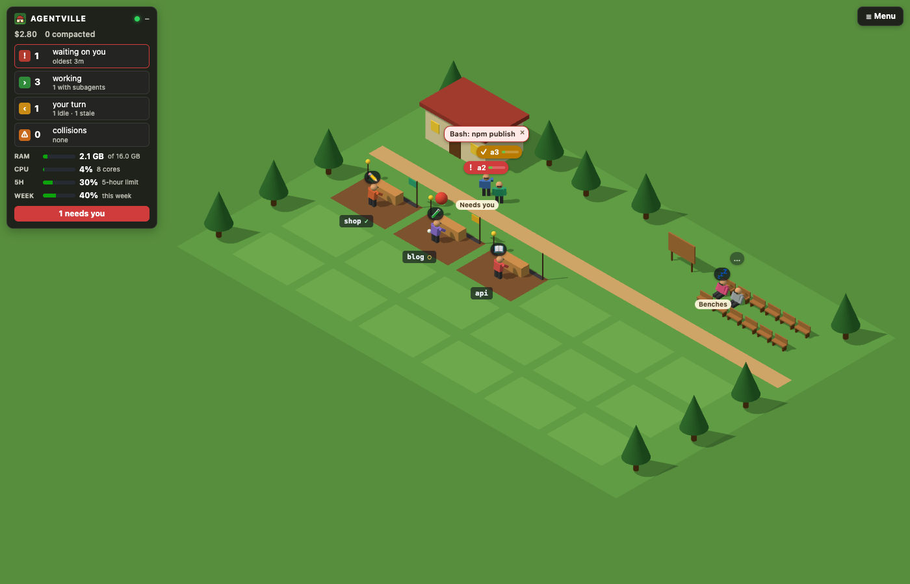

# Worlds

A world is a way to draw what the dashboard knows: the tennis club is one, the farm another. This
guide is for people and coding agents who make their own. Start at [Making a world](#making-a-world);
the other sections are the reference it points to.

## What a world is

A world is a folder:

```
my-world/
  world.json    the world: its ground, places, plots, scenery and figures (required)
  sim.js        rules of its own for who stands where (optional)
  view.js       looks of its own, drawn with three.js (optional)
  assets/       the models (.glb) and pictures (.png, .webp, .jpg) those three name (optional)
  preview.png   its picture in the list of worlds (optional)
```

`world.json` describes the world, and the SDK does the rest the same way for every world:

- the **simulation** gives each agent a spot by its state and walks it there;
- the **stage** draws the world with [three.js](https://threejs.org);
- the **HUD**, the name tags, the speech bubbles and the dialogs lie over it as HTML.

So a world differs from another by what it describes, not by how it works. Most worlds need no code.

Lengths are metres. A point on the ground is `[x, z]`: `x` to the right, `z` towards the viewer,
from the ground's far left corner. Heights are `y`, upwards.

The dashboard runs a world in a sandboxed frame. The frame gets the **scene** (plain facts about
agents and repos) and reaches the page only through **messages**, each of which the page checks. It
has no token, cookies or storage and cannot fetch anything ("What a world can't do").

Keys: the built-in worlds are `farm`, `factory`, `tennis` and `starter`. Yours are `u/<name>`. A
name matches `^[a-z0-9][a-z0-9-]{0,39}$`; `sdk`, `legacy`, `starter`, `legacy-starter`, `test` and
`u` are reserved.

## The worlds that come with Agentville

| World | Key | What it is |
|---|---|---|
| 🌾 **Farm** | `farm` | The default: every agent a farmer, every repo a field, with animals. Pixel art ("The pixel engine") |
| 🤖 **Robot factory** | `factory` | Every agent a robot, every repo an assembly bay. Pixel art |
| 🎾 **Tennis club** | `tennis` | Every agent a player, every repo a court. The full example of this guide: models, a figure with its own clips, a `view.js` |
| 🌱 **Starter** | `starter` | The template `new-world` copies. Not in the list of worlds, but the test page and `check-world` run it |




## Making a world

If you are Claude Code making a world for someone, follow these steps in order and show them the
world-shots pictures.

1. `agentville new-world <name>` copies the starter into your worlds folder as `<name>/`. In a clone
   of the repo the same commands are `npm run new-world -- <name>` and `npm run check-world -- …`.
   `--worlds <dir>` uses another folder; pass it to `check-world` and `world-shots` too.
2. Edit `world.json` ("world.json"). Set `icon`, `description` and `nouns`, then the ground, the
   places, the plots and the scenery. Keep `sim.js` and `view.js` only if the world needs rules or
   looks of its own ("sim.js", "view.js"); else delete them.
3. Open the test page, `http://localhost:7777/worlds/test?world=u/<name>` (`new-world` prints your
   port). It plays the tour ("The test page and the tour"). Reload it after each save.
4. `agentville check-world u/<name>` reads `world.json` and runs the tour without a browser. Fix
   every line with a ✗ and read the lines with a · ("check-world").
5. `npm run world-shots -- u/<name>` (in a clone, needs Chrome) saves a picture of each stop to
   `.private/shots/u-<name>/`. Look at each one.
6. Choose it in the dashboard: **World**, then its name. Saving a file reloads it. It gets the
   private scene until you tick **Can see what agents say** ("Privacy mode").

## Where worlds live

- **Built in:** `web/worlds/<name>/` in the install. They can't be replaced: a world of yours named
  `farm` is `u/farm`.
- **Yours:** `~/.agentville/worlds/<name>/`, or the folder set in **⚙ Settings › Worlds**. A world
  folder may be a link to the world's own folder elsewhere.

A world's files are served to anything on this computer that asks for them by path, so keep nothing
secret in the folder. A folder that breaks a rule is listed with its error and does not run.

### Reloading as you edit

When a world's files change, the dashboard reloads its frame. Zoom and scroll position come back. A
world folder that is a link isn't watched, and neither is the test page: reload the page.

## world.json

The smallest world: a place for those who need you and a place for the rest.

```json
{
  "name": "Minimal",
  "api": 2,
  "places": {
    "wait": { "spots": [[10, 8], [12, 8], [14, 8]] },
    "idle": { "spots": [[30, 8], [32, 8], [34, 8]] }
  }
}
```

| Field | Rule | Meaning |
|---|---|---|
| `name` | 1 to 40 characters | Shown in the list of worlds and on the view button |
| `icon` | optional, one emoji; 🧩 without | Beside the name. `preview.png` replaces it in the list |
| `description` | optional, up to 140 characters | One line in the list |
| `api` | `2` | The version of this guide the world was written for |
| `nouns` | optional; `agent`, `agents`, `repo`, `repos`, `place`, `start`, `diary`, each up to 30 characters | What the world calls things, in the HUD, the help and the diary's title |
| `help` | optional, up to 600 characters | A sentence or two at the top of the world's Help |
| `ground` | optional `{ size: [width, depth], color }`; 48 × 32 m of green without | The ground. Each side is 8 to 400 m. At 100% zoom the whole ground is in the frame |
| `camera` | optional `{ view, yaw?, pitch? }`; `iso` without | How the world is seen ("The camera") |
| `sky` | optional `{ day, night }` | The colours behind the world by day and at night |
| `places` | required; `wait` and `idle` at least | Where agents stand by their state ("Places") |
| `plots` | optional | One plot for each repo ("Plots") |
| `paths` | optional | The ways agents walk along ("Paths") |
| `spawn` | optional `[x, z]`; the first `wait` spot without | Where a new agent appears |
| `speed` | optional, 0.2 to 10; `1.6` without | Walking speed in metres a second |
| `scenery`, `prefabs` | optional | What stands in the world ("Scenery") |
| `figure` | optional | What an agent looks like ("Figures") |
| `steps` | optional | The world's own sign, word or model for a kind of work ("Steps") |

A colour is `"#rrggbb"`. The file is at most 64 KB. A field this version does not know is ignored;
`check-world` names it, since it is most often a typo. Keep the ground small enough to read: about
45 m wide for figures of 1.7 m.

### Places

A place is a named set of spots. Each agent goes to one by its state:

| The agent | goes to |
|---|---|
| works in a repo that has a plot | its repo's plot ("Plots") |
| works, and its repo has no plot (or it is in none) | `work`, else `idle` |
| waits on you | `wait` |
| its turn ended | `turn`, else `wait` |
| is idle, or naps | `idle` |
| is stale | `stale`, else `idle` |

`wait` and `idle` are required; `turn`, `stale` and `work` are for a world that wants them apart.
A world has up to 16 places. The rest, under names of your own (`^[a-z][a-z0-9-]{0,23}$`), are for
the rules in your `sim.js`.

A place gives its spots in exactly one of four ways:

```json
"wait":  { "spots": [[10, 8], [12, 8]] },
"idle":  { "row":  { "from": [30, 5], "step": [1.5, 0], "count": 8 } },
"stale": { "grid": { "from": [30, 9], "step": [1.5, 2], "cols": 4, "count": 8 } },
"turn":  { "ring": { "center": [20, 20], "radius": 3, "count": 6 }, "face": { "to": [20, 20] }, "name": "Campfire" }
```

- At most 64 spots a place. An agent keeps its spot while it stays; a newcomer takes the first free
  one. With every spot taken, the rest are counted, not shown: the place's label says `+3`.
- `face`: the way those standing there look, `[dx, dz]`, or `{ "to": [x, z] }` for a point they all
  look at. Without it they look at the viewer.
- `name`: up to 30 characters, written at the place.

### Plots

A repo's plot is where its agents work. The collector gives every repo a **bed**, a number from 0
to 17 that it keeps, so every browser shows the same repo on the same plot. Bed `i` is plot `i`.

```json
"plots": {
  "grid": { "origin": [6, 14], "step": [6.3, 4.9], "cols": 6 },
  "size": [5.5, 3.8],
  "work": [[0, 0.4], [-1.5, 0.4], [1.5, 0.4]],
  "face": { "to": [0, -1.1] },
  "label": [0, 2],
  "scenery": [{ "shape": "plane", "size": [5.5, 3.8], "color": "#7a5230" }],
  "empty": [{ "shape": "plane", "size": [5.5, 3.8], "color": "#6aa84f" }]
}
```

| Field | Meaning |
|---|---|
| `grid` or `at` | The plots' centres: `grid` lays them out from `origin` in rows of `cols` (3 without), `step` apart; `at` lists them, `[[x, z], …]`, 18 at most |
| `max` | How many plots there are, 1 to 18; 18 without. A repo whose bed is past it has no plot |
| `size` | A plot's `[width, depth]`: where a click opens the repo's close-up. 8 × 6 without |
| `work` | Where its agents stand, as offsets from the centre; up to 12. Past the last, the same spots again, 1.2 m nearer the viewer |
| `face` | The way they look. Here `{ "to": … }` is measured from the plot's centre |
| `label` | Where the repo's name sits, from the centre |
| `scenery` | What stands on a plot that has a repo, placed from the plot's centre ("Scenery") |
| `empty` | What stands on a plot that has none |

### Paths

Without paths, agents walk straight to their spots. With them, an agent steps onto the nearest
path, takes the shortest way along the paths, and steps off nearest its spot.

```json
"paths": [
  [[2, 10], [42, 10]],
  [[22, 10], [22, 26]]
]
```

- A path is a line through 2 to 64 points; up to 32 paths, 256 points in all.
- Paths join wherever they touch or cross. No point is needed there.
- A walk of 4 m or less goes straight. So does one that would be longer by the paths' way on and
  off than it is straight.

### Scenery

`scenery` lists what stands in the world. Each thing is a plain shape, a model or a prefab:

```json
"prefabs": {
  "tree": [
    { "shape": "cylinder", "size": [0.4, 1.3, 0.4], "color": "#6b4320" },
    { "shape": "cone", "size": [2.1, 2.8, 2.1], "y": 1.1, "color": "#2f6b2f" }
  ]
},
"scenery": [
  { "shape": "plane", "size": [41, 1.4], "at": [22, 9.6], "color": "#c9a46a" },
  { "shape": "box", "size": [6, 2.8, 3.8], "at": [6, 4.2], "color": "#e8d8b0", "opens": "session", "tip": "The hut: start a session" },
  { "model": "assets/fountain.glb", "at": [22, 4], "scale": 1.5 },
  { "use": "tree", "each": [[1.5, 1.8], [11.5, 2.2], [16, 3]] }
]
```

| Field | Rule | Meaning |
|---|---|---|
| `shape` | `box`, `cylinder`, `cone`, `sphere` or `plane` | A plain shape. With `size` and `color`; `opacity` (0.05 to 1) for glass |
| `size` | `[width, height, depth]`; `[width, depth]` for a `plane` | In metres. A plane lies flat |
| `model` | a `.glb` in `assets/` | A model ("Models and pictures"). With `scale` (0.01 to 100) |
| `use` | a prefab's name | Everything the prefab holds, as one. With `scale` |
| `at` or `each` | `[x, z]`, or a list of up to 400 | Where it stands; `each` puts one at every point |
| `y` | −50 to 200; `0` without | How high its foot is above the ground. Lay one plane on another with a `y` of a few centimetres |
| `turn` | degrees | Turned about its upright axis |
| `glow` | `true` | It shines at night: a window, a lamp |
| `opens` | `session`, `board`, `repos` or `help` | A click on it opens Start a session, the notice board, the repos in the list view, or the world's Help |
| `tip` | up to 80 characters | Its tooltip |
| `shows` | on a plot only | See below |

A prefab is a list of shapes and models, each placed from the prefab's own centre; up to 32
prefabs of 24 parts. Its parts can't `use` another prefab, and `opens` goes on the thing that uses
it. Up to 400 things in `scenery`, 40 on a plot, 4000 in the world.

Shapes of one kind and colour are drawn in one call, however many there are, and so is a model that
stands in many places. A forest of one tree prefab costs two calls.

**What stands on a plot can show its repo.** Give a thing in `plots.scenery` a `shows`:

| `shows` | The thing |
|---|---|
| `deploy` | takes the last deploy's colour: green ok, red failed, amber running, grey otherwise. Not there without a deploy |
| `context` | grows with the context the plot's agents have used: a shape in height, a plane in width from its left edge |
| `collision` | is there only while two agents write the repo at once |
| `busy` | is there only while an agent works on the plot |

### The camera

| `view` | What you see |
|---|---|
| `iso` | From a corner, looking down, without perspective. The default |
| `tilt` | From the front, looking down, without perspective |
| `top` | Straight down: a flat, two-dimensional world |
| `orbit` | With perspective. Dragging with the right button (or Alt) turns the view |

`yaw` (−180 to 180 degrees, the side the camera stands on) and `pitch` (10 to 90, how steeply it
looks down) change a view's angle.

### Figures

Every world's figures move the same five ways: `idle`, `walk`, `work`, `wait` (it waves: it needs
you) and `sleep` (idle, napping or stale). Without a `figure`, an agent is the SDK's own person, in
the agent's colour.

```json
"figure": { "model": "assets/player.glb", "height": 1.75, "tint": "Shirt", "hand": "HandR",
            "clips": { "idle": "Stand", "walk": "Walk", "work": "Swing", "wait": "Wave", "sleep": "Rest" } }
```

| Field | Meaning |
|---|---|
| `model` | A `.glb` with animation clips. It is scaled to `height` |
| `height` | 0.5 to 4 m; `1.7` without. The SDK's person has it too |
| `tint` | The name of the model's material that takes the agent's colour |
| `hand` | The name of the model's node that holds a step's model ("Steps"): its wrist. Without it the model is held before the figure's middle |
| `clips` | The model's name for each move, where it is not the move's own name. A move without a clip plays `idle` |

Until the model has loaded, and if it can't be, the SDK's person stands in.

### Steps

Over each agent at work is a sign for the kind of step it is at. The SDK's signs and words:

| Step | Sign | Step | Sign | Step | Sign |
|---|---|---|---|---|---|
| `edit` | ✏️ editing | `write` | 📄 writing a new file | `read` | 📖 reading |
| `search` | 🔍 searching | `web` | 🌐 on the web | `mcp` | 🔌 using a connector |
| `skill` | 📜 following a skill | `test` | 🧪 running the tests | `lint` | 🧹 tidying up |
| `build` | 🔨 building | `install` | 📦 installing | `commit` | 🔖 committing |
| `push` | ⬆️ pushing | `deploy` | 🚀 deploying | `pull` | ⬇️ pulling |
| `serve` | 🖥️ keeping a server running | `delete` | 🗑️ deleting | `agent` | 📣 calling helpers |
| `plan` | 📋 planning | `ask` | ❓ asking you something | `shell` | ⌨️ running a command |
| `other` | 🔧 working | `planMode` | 📐 drawing up plans | | |

A world changes the ones it likes:

```json
"steps": {
  "test": { "glyph": "🎾", "verb": "serving" },
  "edit": { "model": "assets/racket.glb" }
}
```

`glyph` is an emoji or a letter or two, `verb` up to 40 characters. A `model` is put in the
figure's hand while it is at that step.

## sim.js

`sim.js` holds a world's own rules for who stands where. It registers its hooks once:

```js
(() => {
  'use strict';
  Agentville.sim({
    place(ctx, agent) { if (agent.mode === 'plan') return 'board'; }, // agents in plan mode gather at the place named board
  });
})();
```

Every hook is optional, and gets `ctx` first:

| Hook | What it does |
|---|---|
| `place(ctx, agent)` | Where the agent belongs. Return a place's name; `{ plot: repoKey }`; `{ at: [x, z], zone? }` for a point of your own; `null` to leave the agent out; or nothing, for the rule in "Places" |
| `scene(ctx, scene)` | Called with every scene, before agents are placed. It may return up to 20 things to pop up: `{ text, cls?, agent? \| repo? \| at? }`, over an agent (its id), a repo's plot (its key) or a point. `cls` is `good`, `warn` or `dim` |
| `tick(ctx, dt)` | Called every step (20 times a second on the collector), `dt` in seconds. Move your own things here. Return `true` when your agents' places changed, and `place` is asked again |
| `share(ctx)` | What your `view.js` needs to know of your own things, as plain data. It is sent to every browser |

`ctx` holds:

| In `ctx` | What it is |
|---|---|
| `world` | The world as `world.json` describes it, every default filled in |
| `layout` | The ground plan: `places` (a Map, name → `{ spots }`), `plotAt(bed)`, `spot(zone, i)`, `route([x, z], [x, z])` |
| `scene` | The newest scene ("The scene") |
| `time` | The world's clock in seconds |
| `now()` | The time of day in milliseconds. Use it instead of `Date.now()` |
| `random()` | A random number from a fixed seed |
| `body(id)` | An agent's body, `{ x, z, tx, tz, walk, zone }`, or `null` |
| `plotOf(repoKey)` | A repo's plot, `{ bed, x, z }`, or `null` |

**This file runs on the collector too** ("One world for everyone"), where there is nothing but the
language: no `document`, `fetch`, `setTimeout`, `performance`, `Intl`, `require` or `import`, and no
files or network. Keep time with `dt` and `ctx.time`. `console.warn` and `console.error` go to
`agentville logs`.

The starter's `sim.js` rolls a ball along the path and shares where it is:

```js
(() => {
  'use strict';
  const ball = { x: 3, dir: 1 };
  Agentville.sim({
    tick(ctx, dt) {
      ball.x += ball.dir * 3 * dt;
      if (ball.x > 41 || ball.x < 3) ball.dir = -ball.dir; // from one end of the path to the other
    },
    share: () => ({ ball: Math.round(ball.x * 8) / 8 }), // rounded: a value is sent again only when it changed
  });
})();
```

A shared key is sent only when its value changed, so round what moves. Limits: 16 keys, names of
letters and digits up to 24, 16 KB each. Never share what an agent or you said: guests get it too.

## view.js

`view.js` adds looks of its own to the stage. It runs in the frame only, and gets three.js through
`ctx`:

```js
(() => {
  'use strict';
  let ball = null;
  Agentville.view({
    setup(ctx) {
      const { THREE } = ctx;
      ball = new THREE.Mesh(new THREE.SphereGeometry(0.45, 20, 14), new THREE.MeshLambertMaterial({ color: '#e04a3a' }));
      ball.castShadow = true;
      ball.position.set(3, 0.45, 9.6); // on the path
      ctx.root.add(ball);
    },
    frame(ctx) {
      const x = ctx.shared.ball; // what sim.js shares
      if (Number.isFinite(x)) ball.position.x = x;
    },
    dispose() { ball.geometry.dispose(); ball.material.dispose(); },
  });
})();
```

| Hook | What it does |
|---|---|
| `setup(ctx)` | Called once, when the stage is built. Add your own objects to `ctx.root` |
| `scene(ctx, scene)` | Called with every scene |
| `figure(ctx, agent)` | A figure of your own for this agent: a three.js object, or `{ object, animate?(move, t, k), setStale?(on), setKids?(n, t), dispose?() }`. Return nothing for the world's usual figure |
| `frame(ctx, dt)` | Called before each frame is drawn |
| `dispose(ctx)` | Called when the world is taken down. Free the geometries, materials and textures you made |

| In `ctx` | What it is |
|---|---|
| `THREE` | three.js. Use this one; don't load another |
| `root`, `camera` | The three.js scene to add your objects to, and the camera. One unit is a metre; `[x, z]` on the ground is `(x, 0, z)` |
| `world`, `layout`, `scene`, `time`, `plotOf(repoKey)` | As in `sim.js`: the same names for the same things |
| `bodies` | Where everyone is now: `[{ id, x, z, tx, tz, walk, zone }]` |
| `shared` | What `sim.js` shares |
| `assets` | `model(path)` gives a promise of `{ scene, animations }`, a copy of your own to place; `texture(path)` a promise of a texture. Paths as in `world.json` |
| `light` | How light it is, 0 at night to 1 by day |
| `invalidate()` | Draw again. With Motion off no frame is drawn by itself: call it when something of yours changed |

Rules:

- **Decide nothing while drawing.** What moves is moved in `sim.js` and shared, or follows from
  `ctx.time` alone, as the tennis club's balls do. Then every browser shows the same.
- A hook that throws is reported once and not called again; the rest of the world goes on.
- The frame's limits hold for your code too: no `fetch`, no workers, no `eval` ("What a world can't
  do"). Load files only through `ctx.assets`.

## Models and pictures

A world's models and pictures are files in its `assets/` folder, named in `world.json` or asked for
in `view.js` as `assets/<file>`. Names are letters, digits, dashes, underscores and dots.

- **Models** are `.glb` (binary glTF 2.0), 16 MB at most. Compressed models (Draco, Meshopt, KTX2)
  are not read: they need what a world's frame may not have. Pictures inside a `.glb` are fine.
- **Pictures** are `.png`, `.webp` or `.jpg`.
- One unit is a metre, `y` is up, and a model's front looks along `+z`. Put its foot at the origin.
- **A figure's model** has a clip for each move ("Figures"); to take the agent's colour, one
  material with a name of its own; and to hold things, a node at its wrist.
- **A step's model** (what a figure holds) has its grip at the origin and points along `−y`, down
  the arm.

Any tool that exports glTF makes them. Blender: **File › Export › glTF 2.0**, format **glTF
Binary**, with **+Y Up** on and compression off.

The tennis club's models are made by `scripts/world-assets.mjs`, from boxes, cylinders and cones
written down as data (`scripts/lib/glb.mjs` writes the file): a tree, a racket, and a figure with
its five clips.

## What every world shows

The SDK shows all of this in every world, so a world can leave it alone. The two stops are the
tour's ("The test page and the tour"): they differ only in the item.

| Item | The two stops | What the SDK shows |
|---|---|---|
| waiting on you | `working`, `waiting` | at `wait`, waving; a red tag with **!** and its name; a bubble with what it asks |
| a question for you | `working`, `question` | as for waiting, with **?** |
| your turn | `working`, `turn` | at `turn` or `wait`; an amber tag with **✓** and its name |
| a repo filling with context | `context-low`, `context-high` | the bar in the agent's tag; on its plot, whatever `shows` `context` |
| a compaction | `compacted-plain`, `compaction` | **Compacted** pops up over the agent; a diary line |
| deploy failed, running, skipped | `deploy-ok` and each | a chip on the plot's label (✓ ✗ ◌ ⏸); whatever `shows` `deploy`; **Deployed** or **Deploy failed** pops up |
| subagents | `working`, `subagents` | a small orb circling the agent for each one running |
| the limits, several accounts | `limits-low`, `limits-high`, `accounts` | the meters in the panel |
| an MCP call, every other step | `working`, `mcp`, `steps` | the step's sign over the agent ("Steps") |
| messages between agents | `two-working`, `pigeon` | a letter flies from one to the other; **✉** where it lands |
| a collision | `two-working`, `collision` | **⚠** on the plot's label; whatever `shows` `collision` |
| a merged pull request | `working`, `merged` | **Merged #12** pops up over the plot; a diary line |
| idle, napping | `working`, `idle`, `nap` | at `idle`, asleep, **💤** |
| stale | `idle`, `stale` | at `stale` or `idle`, grey and still, **…** |
| night | `day`, `night` | dark, and whatever has `glow` shines |
| privacy mode | `private` | numbers for names, everywhere |

The HUD is the same in every world: top left, a panel with the cost, the counts, memory, processor
and the plan's limits; top right, a **Menu** with the dashboard's buttons, Follow, Resting,
Bubbles, Sky, Motion, the bell, Screen, Help and zoom. A click on an agent opens it in the sidebar;
a click on a plot or its label lists the files agents touched there.

A world of api 2 has no animals yet.

## One world for everyone

The collector moves a world, not the browser showing it. It runs the SDK's simulation with the
world's `world.json` and `sim.js`, and sends every browser where everyone is, so all viewers see
the same thing at the same moment. Without a connection to the collector, each browser moves the
world itself, with the same code.

- **On the collector** `sim.js` runs shut in, in a JavaScript engine that has the language and
  nothing else. `view.js` and the assets are never loaded there.
- **Limits.** 64 MB of memory, 3 s to load and 0.8 s a step. A world that exceeds them is stopped
  there, and browsers move it themselves.
- **What it knows there.** A world of yours gets the private scene, always, whatever **Can see
  what agents say** says in a browser ("Privacy mode"). A built-in world gets names, but nothing an
  agent or you said: what the collector sends out is the same for you and for a guest. So no rule
  in `sim.js` may depend on words.
- **Each browser's own:** its switches (Sky, Motion, zoom, Bubbles, Resting, the bell) and what is
  picked. They change how the world is drawn, never where anyone is.

The page, not the world, shows who is watching. A world never gets viewers' names or counts.

## The scene (version 1)

The page builds the scene from each snapshot and sends it to the frame. It holds facts only; each
world turns them into its own pictures.

```
{ version: 1, generatedAt, private: false,
  plan: { windows: [{ kind, pct, resetsAt, reset }], fiveHour: window|null, weekly: window|null } | null,
  codexPlan, accounts: [{ key, name, plan }],
  chrome: { counts, asking, agents, oldestWaiting, subagentsRunning, ram, cpu, collector, errors },
  subagents: [{ id, label, type, state, parent, by, startedAt, endedAt, background, codex, result }],
  subagentCounts: { done, overflow },
  mail: [{ from, to, at, text }],
  mcp: [{ server, busy }],
  repos: [{ key, name, branch, onMain, dirty, ahead, behind, deploy, collision, worktree, main, project, projectName, prs, bed }],
  agents: [{ id, name, kind, cwd, state, since, repo, tool, summary, step, contextPct, hot, ask, askKind, question, reply, said,
             colorIndex, color, cost, mode, kids, work, timeline, startedAt, tasks, compactions, thinking, turn, effort,
             model, family, fast, planAsk, service, jobs, wakeAt, nap, account }] }
```

Times are milliseconds since 1970.

**The whole scene**

- `private`: `true` for a world of yours that may not see what agents say ("Privacy mode").
- `plan`: the Claude plan's usage limits, or `null`. Each window has `kind` (`five_hour`,
  `seven_day`, …), `pct` (0–100 used), `resetsAt` and `reset` (it has reset since it was read).
  `fiveHour` and `weekly` are two of them by name. With several accounts it is the first account's.
- `codexPlan`: Codex's limits in the same shape, with `planType` and `credits`, or `null`.
- `accounts`: your Claude accounts, each `{ key, name, plan }`. Never an email or organization.
- `chrome`: what the dashboard's top bar says. `counts`: agents per state (`waiting`, `working`,
  `yourTurn`, `idle`, `stale`) and `collisions`. `asking`, `agents`, `subagentsRunning`: counts.
  `oldestWaiting`: since when the longest-waiting agent waits. `ram`: `{ usedMb, totalMb }`. `cpu`:
  `{ used, cores }`, `used` in percent of one core. `collector`: `{ pid, cpu, rssMb, claudeVersion }`.
  `errors`: failing sources, as short lines.
- `subagents`: `label` is its task, `type` its kind (`Explore`…), `parent` its agent's name, `by`
  its agent's id, `background` whether its agent waits for it, `codex` whether its agent is a Codex
  thread, `result` the first line of its answer once done.
- `subagentCounts`: `done` finished lately (up to 6); `overflow` running beyond the four an agent
  leads.
- `mail`: messages between agents in the last 3 minutes, oldest first; `from` and `to` are agent ids.
- `mcp`: MCP servers called in the last hour (up to six); `busy` is the calling agent's id or `null`.

**Each repo** (`repos`)

- `key`: its folder, also its id. `name`: the folder's name.
- `branch`, `onMain` (the branch is `main` or `master`), `dirty` (uncommitted files), `ahead`,
  `behind`.
- `deploy`: `{ state, label, detail, url, source }` or `null`. `state` is `running`, `ok`, `failed`,
  `blocked` (a run GitHub never started) or `other`. Draw every state you don't name one way.
- `collision`: two agents writing in it at once: `'high'` (one used git), `'normal'` or `null`.
- `worktree`: it is a git worktree; `main`: the repo it belongs to.
- `bed`: its bed in the repo grid (0, 1, 2…). The collector assigns it so every browser shows the
  same layout. The repo's plot is the one of that number ("Plots").
- `project`, `projectName`: id and label for grouping repos that share a parent folder, or `null`.
- `prs`: `{ open: [{ number, title, url, draft, branch, checks }], merged: [{ number, title, url, at }] }`
  or `null`; `checks` is `ok`, `failed`, `running` or `null`.

**Each agent** (`agents`)

- `id`, `name`; `kind`: `interactive`, `background`, `codex`…; `cwd`: its folder.
- `state`: `waiting` (on you), `working`, `turn` (its turn ended), `idle` or `stale`. `since`: when
  it entered that state.
- `repo`: the `key` of the repo it works in, or `null`.
- `tool`: its current or last tool. `summary`: what that call does. `step`: the kind of work
  (`edit`, `read`, `search`, `test`, `build`, `commit`, `push`, `deploy`, `web`, `mcp`…) or `null`.
- `contextPct`: share of its context window used, 0–1. `compactions`: how often it was compacted.
- `hot`: its CPU is over the alert threshold.
- `ask`: what it asks you. `askKind`: `question`, `permission`, `always` or `null`. `planAsk`: a
  plan waits for approval.
- `question`: a question it ended its turn with. `reply`: the first line of its last reply. `said`:
  its last reply as one line, up to 160 characters.
- `colorIndex`, `color`: its colour, one of eight, fixed by its id.
- `cost`: US dollars so far. `mode`: its permission mode. `effort`: its effort setting.
- `account`: the `key` of its Claude account, or `null` for Codex.
- `kids`: its running subagents, up to four: `{ id, dog }`, `dog: true` for an Explore one.
- `work`: `{ steps, failed, streak, lastTest }`: tool calls by kind of step, how many failed, how
  many failed in a row, and `{ ok, at }` of its last test run.
- `timeline`: its steps of the last half hour, `{ at, step, ok }`. `startedAt`: since when it runs.
- `tasks`: `{ done, total, current?, items }` or `null`.
- `thinking`: it is thinking now. `turn`: while working, `{ startedAt, outTokens?, word?, mode? }`.
- `model`, `family` (`opus`, `sonnet`, `haiku`, `fable` or `null`), `fast`.
- `service`: where a web or connector call goes (`Gmail`, `github.com`…).
- `jobs`: background commands running.
- `wakeAt`: when it wakes by itself. `nap`: it is a `/loop` session resting until then.

## The starter world

`web/worlds/starter/` is the world `new-world` copies: a `world.json` of 66 lines, and a `sim.js`
and a `view.js` of about 20 lines each.

- plots: six across, three deep, each with a desk, a bar for the context used, a flag for the last
  deploy, a lamp while someone works and a cone for a collision;
- the hut: a click starts a session; in front of it, whoever needs you;
- the benches: everyone else; the notice board beside them;
- paths between the rows, and trees from one prefab;
- a ball rolling along the path: `sim.js` moves it, `view.js` draws it. Delete both files and the
  world works as before, without the ball.


## The test page and the tour

The test page shows a world playing the **tour**: made-up snapshots, one stop for each thing a
world may have to show. It uses no real data. Open it with the dashboard running:

```
http://localhost:7777/worlds/test?world=<key>&stop=<name>
```

- `world`: `tennis`, `starter`, `farm`, `factory` or `u/<folder>`.
- `stop`: one stop by name. Without it the page plays the whole tour, 4 seconds a stop.

The page lists what the world asked it to do (picks, files to open, `nav`, the bell…) instead of
doing it. Requests (`agentFiles`, `repoTouched`) get made-up answers; a world's own files are read
from its folder as ever. Settings are kept in memory
only. At the `private` stop every world gets the private scene; at every other stop, the whole one.
A world that breaks shows the same panel or strip as on the dashboard.

**For a screenshot**, wait until `document.body.dataset.shown` is the stop's name:

```js
await page.goto('http://localhost:7777/worlds/test?world=u/my-world&stop=deploy-failed');
await page.waitForFunction(() => document.body.dataset.shown === 'deploy-failed');
await page.screenshot({ path: 'deploy-failed.png' });
```

**A picture of every stop:**

```
npm run world-shots -- <world> [--stop <name>] [--dir <folder>] [--worlds <dir>]
```

It needs Chrome (`CHROME` sets its path) and a clone of the repo. It starts its own server on
made-up data and saves `<stop>.png` at 1280 × 820 to `.private/shots/<world>/`. The clock and random
numbers are frozen, so the same world gives the same pictures. A ✗ names a stop that didn't show in
15 seconds; the run then exits with 1.

The stops, in the tour's order:

| Stop | What it shows |
|---|---|
| `everyone` | A busy morning: every state at once |
| `one`, `sixteen`, `nobody` | One agent, sixteen, none |
| `working` | Working: editing a file |
| `waiting`, `question`, `plan-ask` | Waiting on you: a permission, a question, a plan to approve |
| `turn` | Your turn: it finished |
| `idle`, `stale` | Idle; untouched for days |
| `nap` | Napping: it wakes up by itself |
| `thinking` | Thinking between steps |
| `steps` | Every step, and plan mode |
| `context-low`, `context-high` | A repo with little context used, and one nearly full |
| `compaction` | A compaction (two snapshots: full, then emptied) |
| `compacted-plain` | After a compaction, without seeing it happen |
| `deploy-ok`, `deploy-failed`, `deploy-running` | A deploy in each state |
| `deploy-skipped` | A run GitHub never started (`state: 'blocked'`) |
| `two-working` | Two agents in one repo |
| `collision` | Two agents writing one repo |
| `pigeon` | A message from one agent to another |
| `merged` | A pull request merged (two snapshots: open, then merged) |
| `mcp` | An MCP call |
| `subagents` | Subagents running and done |
| `limits-low`, `limits-high` | The 5-hour and weekly limits, barely used and nearly used up |
| `accounts` | Two Claude accounts |
| `day`, `night` | By day, by night |
| `private` | Privacy mode: no words, paths or names |

## check-world

```
agentville check-world <world> [--worlds <dir>]      # in a clone: npm run check-world -- <world> [--worlds <dir>]
```

`<world>` is `tennis`, `starter`, `u/<folder>` or `<folder>`. It needs Node 22.13 or later.

It reads `world.json` as the SDK reads it, looks for every file it names, and runs the simulation
(with your `sim.js`) through every stop of the tour, as the collector runs it. Your code runs where
it can reach no file, no network and no program, so a world you don't trust can be checked. That
holds for a world of `"api": 2` only: one that says `"api": 1` is checked the older way, where its
code can reach the network (`worlds-legacy.md`).

It reports, a line each:

- **✗** a problem in `world.json`, naming the field;
- **✗** a model or picture that is named and not there;
- **✗** an exception in `sim.js`, with its stop and line (`sim.js:12`); the same one at many stops
  is said once;
- **✗** a hook that doesn't return within 2 seconds;
- **✗** a `view.js` that doesn't parse. It is not run: look at what it draws on the test page;
- **·** a field of `world.json` this version does not read;
- **·** a place with fewer spots than a stop needs, and how many more;
- **·** agents your `place()` left out;
- **·** spots off the ground;
- **·** what your `sim.js` wrote to its console.

It exits with 1 when any line has a ✗:

```
check-world: u/my-club (/Users/you/.agentville/worlds/my-club)
  · contained: it can read only the SDK and this world's folder, and can't write or start programs; the world's own code runs where it can reach nothing
  ✗ 29 stops of the tour: 6 problems
  ✗ (loading): assets/net.glb is missing. (world.json)
  ✗ everyone (and 4 more stops): no place for the stale (sim.js:3)
  · world.json: "senery" is not a field this version reads
  · wait has 4 more than it has spots at "sixteen": they are counted, not shown
```

## Privacy mode

A world from your folder gets a private scene (`scene.private` is `true`) until you tick **Can see
what agents say** for it in the list of worlds. Built-in worlds always get the whole scene.

A private scene keeps states, tools, steps, subagent types, colours, counts, percentages, costs, the
plan's windows and the repos' numbers. It replaces:

- **Agents:** `name` is `agent N`. `summary`, `ask`, `reply` and `said` are `''`. `question`, `cwd`
  and `service` are `null`. `tasks` is `{ done, total }`. `repo` and `account` are stand-ins.
- **Accounts:** `key` is `a1`, `a2`…; `name` is `account 1`…
- **Repos:** `key` and `main` are stand-ins (`r1`…), `name` is `repo N`, `project` is `p1`… with
  `projectName` `project N`, `branch` is `null`. `deploy` keeps only `state`. `prs` keeps
  `{ open: [{ number, checks, draft }], merged: [{ number, at }] }`.
- **The rest:** `subagents[].label` and `mail[].text` are `''`, `subagents[].parent` is `agent N`,
  `chrome.errors` is `[]`.

Stand-ins stay the same for the same agent or repo while the page is open. Requests (`agentFiles`,
`repoTouched`) are refused with `status: 403`, and `openDoc` is dropped. `pick` still works, and a
world still gets its own files (`asset`).

Names are removed because a world can leak what it sees ("The gaps"), and session, folder and repo
names can name clients or work.

## Messages

A world of this guide never sends these itself: the SDK does, for what you click and for what the
world needs. They are listed because the page checks each one, whoever sends it. Every message is
an object with a `type`.

**From the page to the frame**

| Message | What it is |
|---|---|
| `start { world, prefs, settings }` | Sent once the frame has loaded: the world's key, its saved settings and the page's settings |
| `settings { settings }` | The page's settings when they change: `{ still, theme, nav: { theme, side, live }, bell, awake, sim }`. `still`: stand still. `theme`: `auto`, `light` or `dark`. `sim`: the collector moves this world |
| `scene { scene }` | Every snapshot, as the scene above |
| `select { id }` | The agent shown in the sidebar, or `null` |
| `chatter { lines }` | The ✨ Helper's animal lines, for a world with animals (the pixel engine's): at most 40 `{ kind, when, text }` |
| `sim { on? \| s? \| fx? \| re? }` | For a world the collector moves: whether it is connected, a state, an effect to show, or the answer to an `act`. The SDK handles these |
| `reply { id, ok, status, data?, error? }` | The answer to a `request` |

**From the frame to the page**

| Message | What the page does |
|---|---|
| `loaded`, `ready` | Sent by the bridge: the world has registered, and has started |
| `error { message, where }` | Shows it in a panel (before `ready`) or a strip (after) |
| `pick { agentId, from?, tab? }` | Opens that agent in the sidebar; with `tab: 'subagents'` on that tab. With `from: 'say'` it opens the conversation instead |
| `openDoc { agentId, path }` | Opens the file in a reader. Only a path in that agent's folder, in a repo of the scene, or one a reply to `agentFiles` named |
| `openLink { url }` | Opens it in a new tab. Only `https://github.com/` links |
| `startSession` | Opens Start or resume a session |
| `showRepos` | Shows the repos in the list view |
| `nav { what }` | Presses a top bar button: `list`, `session`, `setup`, `side`, `broadcast`, `theme` or `worlds` |
| `bell { on }` | Turns the page's bell on or off |
| `awake { on }` | Keeps this device's screen on. Needs HTTPS or `localhost`; the result comes back in `settings.awake` |
| `motion { still }` | The world stood still, or moves again |
| `diary { entries }` | Shows the world's diary in the sidebar: at most 20 `{ at, state, who, text }`, shown as text |
| `cast { animals }` | The world's animals, for the ✨ Helper's lines (the pixel engine's worlds) |
| `act { rid, animal, act, doer? }` | Asks an animal for one of its actions, in a world the collector moves |
| `touch { animal }` | A shy visitor was touched |
| `store { key, value }` | Saves one of the world's settings. Names match `^[a-z][a-z0-9-]{0,31}$`; 64 settings and 64 KB at most |
| `request { id, kind, agentId? \| repo? \| path? }` | Reads `agentFiles` (an agent's files and memory), `repoTouched` (the files agents touched in a repo) or `asset` (one of the world's own files, `assets/…`, as bytes of up to 16 MB: a frame can't fetch, so its models come this way). Answered with `reply`; four at a time, 30 seconds each |

The page takes each action (`pick`, `openDoc`, `openLink`, `startSession`, `showRepos`, `nav`) at
most once a quarter second and drops the rest. A world that is out of sight can do none of them;
`store`, `diary` and `request` still work.

## When a world breaks

The page never leaves the user stuck in a broken world:

- **A `world.json` with something wrong** is listed with what is wrong, and does not run.
- **It must start within 5 seconds.** A world whose frame doesn't is replaced by a panel with the
  first error and the buttons **Back to the farm**, **Show the list** and **Try again**. Saving a
  file reloads the world.
- **It must stay in its frame.** A world that navigates away is stopped and replaced by a panel.
- **An error after it started** shows in a strip over the world, which keeps running. A hook of
  `view.js` that throws is reported once and not called again; a model that can't be loaded is
  left out.
- **Errors show with message and line** (`sim.js:12`, `view.js:30`).
- **A browser without WebGL** shows a line saying so in place of the world.

## What a world can't do

- Read a token, cookies or storage.
- Fetch, post or upload anything, open popups, dialogs, forms or workers, or load another address
  into a frame.
- Load scripts from anywhere but the dashboard's server; no inline scripts and no `eval`.
- Start a worker or run WebAssembly.
- Read the page or the dashboard's API.
- Make the page do anything but the messages above.

It can use pictures, fonts, sounds and stylesheets from its own folder, inline styles, and `data:`
pictures, fonts and sounds.

## The gaps

The sandbox protects your token and every action: a world can never act for you. It does not fully
protect the secrecy of what a world is shown. Browsers leave ways to signal another machine that the
page cannot close: a connection hint (`preconnect`, `dns-prefetch`) to a host the world names,
WebRTC, and the one request sent when a frame navigates away.

So treat the scene a world gets as visible to its author. For a world of yours that is the private
scene; once you tick **Can see what agents say**, it includes names, paths and what agents say. Add
only worlds you trust.

## The pixel engine

The farm and the robot factory are worlds of `"api": 1`: a `world.js` of hooks that paint pixels on
a canvas, with kits for people, props and animals. They run beside the worlds of this guide, and
worlds of yours made that way keep working. [worlds-legacy.md](worlds-legacy.md) is their
reference. New worlds are made as this guide says; the pixel engine goes once its worlds have been
moved over.
